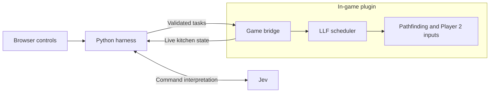

# Sous Chef

Sous Chef is a voice controlled Jev-based AI agent that can play as your assistant chef. Ask it to prepare and toss you ingredients, assemble dishes, deliver dishes, wash dishes, etc.

Currently in assistant mode only, automatic multi-agent mode coming soon...

## Architecture


This architecture is far more effective, cheap, fast and reliable compared to using any LLM workflow. All of the intricacies for the agent's behaviour is programmed, not speculated by Jev. Jev is only used to make high level decisions on what should be done based on your voice input. Thus, on average, most Overcooked rounds using this agent costs less than $0.008, even with many voice commands, while being more than capable enough to be able to assist the human player with getting three stars on most levels.

- **Plugin.** A C# plugin runs inside the game via BepInEx. It reads the live
  kitchen state and sends inputs to Player 2.
- **OS-inspired LLF task scheduler.** Least Laxity First uses slack, the time until a deadline
  minus the estimated work left. The scheduler favors ready tasks with less
  slack and can switch to prep work while food cooks.
- **Programmatic pathfinding.** The navigator uses the game's physics to check
  walkable routes, searches them with Dijkstra or A*, and replans when a path is
  blocked.
- **Jev.** The Python harness uses Jev to match requests to supported tasks and
  targets in the live kitchen. The harness asks for clarification when needed,
  validates the plan, and shows a preview by default.

## Run locally

You’ll need macOS, Python 3.12+, and Overcooked! 2 installed through Steam.

1. Open Steam and quit the game if it’s running. From the repo root, install the
   plugin and launch the game.

   ```sh
   python3 scripts/install.py
   python3 scripts/launch.py
   ```

2. In the game, add Player 2 with **Split Controller** and enter an **Arcade →
   Couch** kitchen.
3. In another terminal, run `python3 -m harness.server --local-only` and open
   [the browser controls](http://127.0.0.1:8765).

For typed or spoken requests, copy [`.env.example`](.env.example) to `.env`, set
`JEV_API_KEY`, and restart the harness. Click **Enable typed Jev commands** or
**Enable microphone**. Voice requires macOS 27+ and Xcode 27’s Swift tools.
