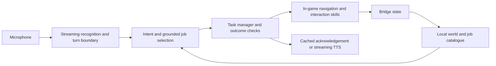

# Decision models and voice for Sous Chef

Research date: **1 November 2026**. This is a selection study, not an inference
benchmark. Public documentation and model cards were checked live. No paid API
requests, model downloads, microphone recordings, or gameplay experiments were
performed for this study. All prices below are USD.

## Recommendation

Start with **Moonshine Small Streaming → Jev 1.14 → the local task executor**,
with cached acknowledgements and Pocket TTS for messages that need synthesis.
Compare Jev against **OpenAI Decisions with GPT-6 Luna**, using exactly the same
grounded task candidates. Both fit the bounded decision interface unusually well.
This recommendation is based on interface and deployment fit; neither provider
has established a latency or task-accuracy win on this game.

For a fully local alternative, first test **Qwen3.5-4B at 4-bit precision**, with
thinking disabled and grammar-constrained output. Increase to Qwen3.5-9B only if
the smaller model makes consequential interpretation errors. The development
machine was inspected: an **M4 Pro, 24 GB unified memory**. The game and inference
share that memory and GPU, so co-running performance matters more than an isolated
language-model benchmark.

If natural ongoing conversation and interruption handling become central, compare
**GPT-Live 1 with native Decisions delegation** and **Gemini 3.8 Live**. These are
stronger candidates for a conversational character than a simple command parser;
they still need the same local task validation and execution layer.

## What this repository currently provides

The referenced bridge chat proposed a voice-directed second couch-co-op chef.
The concrete example was collecting dirty plates and washing them, with a model
choosing high-level work and code handling movement and interactions. The chat
also discussed Cortico's existing actions; those are not automatically features
of this independent implementation.

The present repository already documents:

- A comprehensive observation stream at a default 5 Hz and a compact gameplay
  stream targeting 20 Hz. These are configured sampling targets, not hard latency
  guarantees. See [protocol](protocol.md).
- `available_actions()`, `navigate_to(destination_id)`, and `stop()`. Navigation
  runs inside Unity, refreshes reachability, and ends at an appropriate native
  interaction stance. See [navigation](navigation.md).
- Native raw Player 2 logical inputs, with exclusive ownership and timeout rules.
  See [control](control.md).

The autonomous navigator explicitly does **not** press pickup, use, or dash.
Verified pickup/deposit/wash skills, a task manager, and voice integration remain
additional work. Arriving beside the sink is not evidence of a completed washing
task. Navigation also has cold-start and planning-budget limits that must be
included in end-to-end measurements.

## Keep the model's job small



The application should compute reachability, ingredient counts, deadlines,
estimated travel time, burn urgency, and recipe dependencies. Give the model the
instruction, current assignment, relevant facts, and a short list of feasible
jobs. A few hundred to roughly 1,500 input tokens is a useful initial experiment
range, not a required format. Do not send the complete scene graph or geometry.

For “wash the dirty dishes,” offer a compound candidate such as
`wash_batch_17_at_sink_4`; code owns its plate references and procedure. Selecting
one grounded candidate avoids independent model fields choosing incompatible
actions, objects, and destinations. Include explicit `clarify`, `unavailable`,
and `no_change` outcomes. Resolve finite requests and standing assignments
separately: “wash those plates” and “keep doing dishes” have different lifetimes.

Recheck the selected job against fresh state before dispatch. Associate every
request with an instruction revision, session/level identity, and candidate-set
revision. Discard late results after interruption, round change, or superseding
speech. Keep one current decision in flight rather than queuing old worlds.
Type-correct output does not establish a feasible or correct action.

The task manager should keep carrying out a valid assignment between model calls.
Reconsider on new speech, completion, a relevant blockage, or a meaningful change
in priorities. Local rules can handle obvious scheduling, immediate hazards, and
the stop hotkey. This also supplies a useful no-model scheduling baseline.

## Hosted decision options

| Option | Fit for this project | Latency evidence and important limits |
| --- | --- | --- |
| **Jev 1.14** (`jev-1.14.0`) | First hosted candidate for intent classification and choosing a supplied job. Choice returns the selected option, option probabilities, and confidence. | Designed for direct typed decisions. The inspected current documentation does not establish end-to-end p50/p95 for our workload. Text input; speech must be transcribed first. No public downloadable weights were found in the documented offering. [Models](https://docs.typesafe.ai/models), [Choice](https://docs.typesafe.ai/primitives/choice) |
| **OpenAI Decisions + GPT-6 Luna** (`gpt-6-luna`) | Closest hosted alternative to Jev: fixed choices, predicates, and rubric scores over text/JSON. | OpenAI advertises about 10× faster decisions than its Responses API; this is a vendor comparison, not a measured advantage over Jev. Supports batched questions. [Decisions guide](https://developers.openai.com/api/docs/guides/decisions) |
| **Cerebras Qwen 3.8 27B** (`qwen-3.8-27b`) | First flexible generative API candidate when a bounded choice cannot express the instruction. Use strict JSON Schema and `reasoning_effort: none`. | Catalog advertises about 1,850 output tokens/s. That excludes enough of the request path that it cannot predict short-request latency. Strict schema support and reasoning-off are documented. [Catalog](https://inference-docs.cerebras.ai/models/overview), [schemas](https://inference-docs.cerebras.ai/capabilities/structured-outputs), [reasoning](https://inference-docs.cerebras.ai/capabilities/reasoning) |
| **Groq GPT-OSS 20B** (`openai/gpt-oss-20b`) | Low-cost generative comparator with strict schema support. | Catalog advertises about 1,000 output tokens/s. Structured Outputs currently excludes streaming and tool use in that mode; ordinary tool calling is a separate interface. Reasoning adds latency beyond the final JSON. [Models](https://console.groq.com/docs/models), [schemas](https://console.groq.com/docs/structured-outputs) |
| **Gemini 3.5 Flash-Lite** (`gemini-3.5-flash-lite`) | General-purpose alternative for instruction interpretation, slots, and short explanations. | Officially positioned for low-latency workloads; supports function calling and structured output. Its audio input does not make it a streaming voice session: this model has no Live API or audio generation support. [Model](https://ai.google.dev/gemini-api/docs/models/gemini-3.5-flash-lite) |

Cerebras also offers GPT-OSS 120B, advertising about 3,000 output tokens/s. Its
reasoning cannot be disabled; `low` is the smallest setting. Qwen with reasoning
off is the more direct first comparison for tiny task-selection responses.
These are provider catalog figures, not same-machine measurements.
[Catalog](https://inference-docs.cerebras.ai/models/overview),
[reasoning controls](https://inference-docs.cerebras.ai/capabilities/reasoning)

Jev questions are evaluated independently. Use code for dependencies between
answers and arithmetic. TypeSafe's published jaggedness notes describe numerical,
indirection, option-order, and irrelevant-context weaknesses for **1.13**; that
page is not a measurement of 1.14. Include those failure cases when evaluating the
new version. [Question behavior](https://docs.typesafe.ai/introduction),
[version-specific limitations](https://docs.typesafe.ai/model-jaggedness/jev-1.13)

### Decision cost is unlikely to decide the project

At current documented rates, Jev costs **$0.042 per million input tokens**, with
free output. Decisions costs **$0.10 per million uncached input tokens**, with no
output charge on that endpoint. Thus 10,000 decisions at 1,000 total billed input
tokens each cost approximately **$0.42** and **$1.00**, respectively, before
applicable premiums. Include question/option overhead in the input count.
[Jev pricing](https://docs.typesafe.ai/models),
[Decisions pricing](https://developers.openai.com/api/docs/guides/decisions)

For comparison, Groq lists GPT-OSS 20B at $0.075 input / $0.30 output per million
tokens. Gemini lists Flash-Lite at $0.30 input / $2.50 output under standard paid
pricing. Generated reasoning can add to generative-model output charges. Free
tiers are useful for development but do not establish suitable quotas or latency
under continuous play. [Groq rates](https://console.groq.com/docs/models),
[Gemini rates](https://ai.google.dev/gemini-api/docs/pricing)

Prefer accuracy and measured tail latency over small differences in decision
cost. Event-driven calls also prevent pointless spending and task oscillation.

## Free local decision models

The memory ranges here are **rough quantized weight budgets**, derived from model
size and typical 4-bit storage overhead. They are not measured resident memory.
Runtime buffers, caches, any loaded vision encoder, speech models, macOS, and the
game require additional memory.

| Model | Approximate 4-bit weight budget | Selection rationale |
| --- | --- | --- |
| **Qwen3.5-4B** | 2–3 GB | First local candidate. Apache 2.0 weights. Has an explicit non-thinking mode; use text only. [Model card](https://huggingface.co/Qwen/Qwen3.5-4B) |
| **Qwen3.5-9B** | 5–6 GB | Quality comparison if 4B fails on negation, corrections, standing instructions, or references such as “that one.” Greater memory/bandwidth pressure. Apache 2.0. [Model card](https://huggingface.co/Qwen/Qwen3.5-9B) |
| **Ministral 3 3B Instruct 2512** | 2–3 GB | Useful independent small-model comparator; native function calling and JSON output. Apache 2.0. Its language component is 3.4B, plus a 0.4B vision encoder. [Model card](https://huggingface.co/mistralai/Ministral-3-3B-Instruct-2512) |
| **SmolLM3-3B** | About 2 GB | Small Apache 2.0 alternative with `/no_think`. Useful if deployment simplicity or a later domain adaptation matters. No established accuracy win on our commands. [Model card](https://huggingface.co/HuggingFaceTB/SmolLM3-3B) |

Use **llama.cpp with Metal** as the initial controlled-output runtime. It supports
JSON Schema/grammar constraints and treats Apple Silicon as a supported target.
Keep the model loaded, use short context, and emit a job ID or a tiny JSON object.
MLX is another sensible Apple runtime to benchmark, but verify constrained
decoding support in the exact server/version rather than assuming an
OpenAI-compatible endpoint guarantees it. [llama.cpp](https://github.com/ggml-org/llama.cpp),
[server constraints](https://github.com/ggml-org/llama.cpp/blob/master/tools/server/README.md)

For Qwen, non-thinking must actually be configured in the runtime's supported
chat-template controls. Hiding reasoning in the returned response does not save
its computation. Do not import an enormous default context allocation from a
generic chat configuration. A local model removes network delay but still has
prompt-prefill and decoding costs, plus contention with the game.

Before using any generative model for routine commands, compare a small intent
classifier or semantic matcher over the supported task vocabulary. Moonshine
already provides semantic conversation-starter matching. This can cover phrases
such as “wash up” and “do the dishes” cheaply; test rejection, negation, and target
selection rather than always selecting the nearest phrase. It will need help
for compound requests and new task combinations. [Moonshine flows](https://moonshine-voice.readthedocs.io/en/latest/using/conversational-agent/)

## Voice: modular pipeline or conversational model

A modular pipeline makes the action path explicit:
**streaming STT → typed decision → task dispatch**, with speech output running
after acceptance. A speech-to-speech model is attractive when the character needs
natural dialogue, expressive voice, and smooth interruptions. Both approaches
still need grounded tools and execution feedback.

### Hosted voice options

| Option | What it provides | Fit and limitations |
| --- | --- | --- |
| **Deepgram Flux** | Streaming recognition with model-integrated turn detection and eager-end events. | First hosted STT comparator. Deepgram advertises about 260 ms end-of-turn detection; this is not the whole voice-to-action path. Speculative preparation can start early and be cancelled if speech resumes. [Flux](https://developers.deepgram.com/docs/flux/quickstart), [eager turns](https://developers.deepgram.com/docs/flux/voice-agent-eager-eot) |
| **Cartesia Ink 2 + Sonic 3.6** | Streaming STT with start/update/eager-end/resume/end events, plus expressive streaming TTS. | Coherent hosted modular option. Ink 2 has built-in turn detection; retain local control of task selection. No comparable end-to-end latency figure was established in this study. [Ink 2](https://docs.cartesia.ai/build-with-cartesia/stt/latest), [Sonic](https://docs.cartesia.ai/build-with-cartesia/tts-models/latest) |
| **ElevenLabs Scribe v2 Realtime + Flash v2.5 or v4 Turbo** | Realtime STT plus low-latency TTS. | Current official medians: about 150 ms to committed transcript and 100 ms to first server-side TTS audio for warm voices. They exclude network/application delay and cannot simply be added to claim user-perceived latency. [Measurement methodology](https://elevenlabs.io/docs/eleven-api/concepts/latency-methodology) |
| **GPT-Live 1 + Decisions** | Full-duplex conversation with a separately chosen decision/backend system. | Particularly good architecture match: native Decisions delegation avoids routing that model request through the app. Live can also use client delegation to an existing service. Voice sessions cost $0.05/minute, about $3/hour if connected for an hour; backend usage is additional. [Live guide](https://developers.openai.com/api/docs/guides/live), [native Decisions](https://developers.openai.com/api/docs/guides/decisions-voice), [voice price](https://developers.openai.com/api/docs/models/gpt-live-1) |
| **Gemini 3.8 Live** | Realtime audio conversation and asynchronous function calls. | Strong alternative for a talking co-op character. Use the regular low-latency Live model before Extended Thinking. JSON Structured Outputs are not supported; validate function names and arguments in application code. [Model](https://ai.google.dev/gemini-api/docs/models/gemini-3.8-live), [Live behavior](https://ai.google.dev/gemini-api/docs/live-api) |
| **GPT-Realtime-2.1 Mini** | A smaller integrated realtime voice/reasoning model. | Another candidate if speech and tool reasoning should live in one model. Official positioning is faster/lower-cost realtime interaction; it does not establish a measured task-dispatch win over the modular pipeline. [Model](https://developers.openai.com/api/docs/models/gpt-realtime-2.1-mini) |

Streaming voice prices and included quotas differ by provider. Compare the cost
of a realistic hour with mostly gameplay and occasional speech, including billed
silence/session time. Cheap per-token decisions do not imply cheap always-open
voice. Cartesia explicitly includes silence in STT audio duration. [Cartesia
billing](https://docs.cartesia.ai/pricing)

### Free local speech recognition and synthesis

| Component | Preferred local options | Why / caveat |
| --- | --- | --- |
| **Speech recognition** | **Moonshine Small Streaming (123M)**; compare Medium Streaming (245M) for accuracy and Tiny Streaming (34M) for load. | Streaming work overlaps speech; MIT code and these English weights. Use the Streaming variants, not the older similarly named Base/Tiny checkpoints. Small is the first balance to test. [Available models](https://moonshine-voice.readthedocs.io/en/latest/models/available-models/) |
| **Recognition alternative** | **Parakeet TDT 0.6B v3 via parakeet-mlx** | Apple-specific MLX implementation and 25-language ASR. Its wrapper exposes chunked streaming; context/chunk settings and transcript revision determine responsiveness. Do not infer live latency from offline transcription speed. Weights are CC BY 4.0. [Implementation](https://github.com/senstella/parakeet-mlx), [NVIDIA card](https://huggingface.co/nvidia/parakeet-tdt-0.6b-v3) |
| **Speech synthesis** | **Pocket TTS** | MIT, CPU-oriented streaming synthesis; the established 100M model advertises about 200 ms to first chunk and faster-than-realtime CPU generation. Newly released 18.2M/6.9M/1.9M English variants are interesting load-reduction experiments; those are not covered by the 100M latency claim. [Repository](https://github.com/kyutai-labs/pocket-tts), [technical report](https://kyutai.org/pocket-tts-technical-report/) |
| **Synthesis alternative** | **Kokoro-82M** | Lightweight Apache 2.0 weights; good candidate for concise fixed-character acknowledgements. Actual startup/playback time still depends on runtime and chunking. [Model card](https://huggingface.co/hexgrad/Kokoro-82M) |

Moonshine's published final-transcript latency starts when its segmenter has
already decided speech ended. It therefore does not include the entire delay
from the last audible word. Its docs also describe a default 0.5-second transcript
update interval; tune and measure settings for this application's response goal.
This metric differs from an acoustic end-of-turn detector's delay. [Benchmark
definitions](https://moonshine-voice.readthedocs.io/en/latest/using/benchmarks/)

Whisper/whisper.cpp remains a useful accuracy and compatibility baseline, but
streaming recognition is the first choice for short commands. A chunked wrapper
around an offline recognizer is not automatically equivalent to a model that
was designed to stream. Measure both on the same microphone commands.

### Local speech-to-speech agents

- **Liquid LFM2.5-Audio-1.5B:** the most interesting small integrated experiment.
  Supports speech/text input and output, interleaved conversational generation,
  and GGUF/CPU deployment. Its LFM Open License is a custom license, not
  Apache/MIT. The model card does not establish a schema-constrained game-tool
  interface or full-duplex interruption behavior. Treat those as separate
  integration questions. [Model card](https://huggingface.co/LiquidAI/LFM2.5-Audio-1.5B)
- **Kyutai Moshi:** a real full-duplex research option with an official MLX
  implementation and 4-bit weights. It is a heavier 7B architecture. The reported
  approximately 200 ms practical latency was on an NVIDIA L4, not this Mac. The
  MLX documentation flags missing echo cancellation in the bare CLI, and the FAQ
  describes a fixed-buffer session limit. These are material for a long game
  session. Its weights use CC BY 4.0.
  [MLX implementation](https://github.com/kyutai-labs/moshi/blob/main/moshi_mlx/README.md),
  [architecture](https://github.com/kyutai-labs/moshi),
  [FAQ](https://github.com/kyutai-labs/moshi/blob/main/FAQ.md)
- **NVIDIA PersonaPlex 7B:** full-duplex, role/voice-conditioned conversation.
  Official setup is not a ready-made Apple Metal integration; code and weights
  have different licenses (MIT and NVIDIA Open Model License). It is a less
  direct first deployment for this 24 GB Mac than a small modular stack.
  Conversation ability alone does not supply reliable game tools.
  [Official repository](https://github.com/NVIDIA/personaplex)

For the first version, a modular local stack is easier to evaluate and gives the
game a clear command interface. Integrated audio models remain worth comparing
once the core tasks work.

## How to make it feel fast

Measure three different outcomes: **accepted command**, **first game input for the
new task**, and **first audible acknowledgement**. Also report task completion
separately. A quick “sure” with delayed movement is not a fast sous chef.

For speech-to-action, the relevant path is:

```text
last audible user sample
  + turn-boundary/transcript-finalization delay
  + decision request time (prefill, reasoning, decode, network, queue)
  + fresh-state validation, catalogue refresh, and Unity dispatch
  = first applied input for the accepted task
```

Recognition should happen during speech. Speculative decisions can overlap the
last part of speech, but do not commit a gameplay action from an unstable partial
sentence: “wash the plates ... actually, leave them.” Cancel obsolete inference
and queued audio on correction. Confirm turn completion before committing.

Initial **engineering targets, not predicted measurements**:

| Outcome | Target |
| --- | --- |
| End of speech → first applied task input | p50 ≤500 ms; p95 ≤1,000 ms |
| Decision request alone, on compact context | p50 ≤250 ms; p95 ≤500 ms |
| Recognized stop → input release | next available Unity handling/update, measured separately from speech recognition |
| Accepted command → cached acknowledgement playback | ≤100 ms, without gating movement on playback |

These targets are deliberately demanding. A local generative model may miss
them at larger prompt sizes while still being a useful offline option. Count
timeouts, rejected stale decisions, and retries rather than dropping them from
latency statistics. Transport acceptance is not proof that Unity applied input.

Keep inference processes warm, reuse network connections, and avoid loading a
model per utterance. Cache phrases such as “On dishes,” “Got it,” and “Can't reach
that.” Generate richer speech only when needed. Use a headset or echo
cancellation for always-listening mode so game audio and the bot's own replies do
not trigger commands. A push-to-talk first version provides an explicit end of
turn and a useful latency baseline; hands-free mode can follow without changing
the task interface.

For orchestration, **Pipecat** is worth adapting: it has a Python pipeline and
local microphone/speaker transport, fitting the existing Python clients. **LiveKit
Agents** is useful when a browser/WebRTC front end is wanted; it also supports
manual push-to-talk, VAD, model turn detection, and STT-owned endpoints. These are
frameworks, not replacement decision models, and do not require moving game
execution into a hosted agent. [Pipecat](https://github.com/pipecat-ai/pipecat),
[local transport](https://github.com/pipecat-ai/pipecat/blob/main/src/pipecat/transports/local/audio.py),
[LiveKit turn handling](https://docs.livekit.io/agents/logic/turns/)

## Small evaluation before choosing a provider

1. Build and validate one complete deterministic task, initially dishwashing,
   including pickup/deposit success, empty-hand requirements, interruption,
   disappearance of plates, and a blocked sink.
2. Create a labeled set of about 100 utterance/world/candidate cases. Include
   paraphrases, negation, self-correction, “keep doing dishes,” “only these two,”
   ambiguous left/right references, impossible requests, and task replacement.
3. Replay the identical cases through Jev 1.14, Decisions, Qwen3.5-4B, and a simple
   intent/scheduling baseline. Add Qwen3.5-9B only if 4B accuracy warrants it;
   add Cerebras Qwen for requests requiring more flexible output.
4. Record complete-valid-decision p50/p95, correct task/target/scope, rejection of
   impossible jobs, clarification rate, stale-result rate, and cost. Do not score
   JSON validity as semantic accuracy. Treat provider confidence thresholds as
   uncalibrated for this domain until checked against these labels.
5. Use the same recorded microphone clips with Moonshine Small/Medium, Parakeet,
   and Flux. Include in-game names, short urgent commands, mid-sentence pauses,
   overlapping conversation, and actual game sound at realistic volume.
6. Run the finalists with the game active. Measure frame-time distribution,
   input-to-motion delay, audio underruns, memory pressure, thermal behavior, and
   last-speech-sample-to-action latency over a long session. Separate cold starts
   and warm operation. Do not compare NVIDIA throughput with Mac latency.

The three configurations to compare first are:

| Configuration | Stack | Reason to choose it |
| --- | --- | --- |
| **Initial recommendation** | Moonshine Small Streaming + Jev 1.14 + cached audio/Pocket TTS | Local audio with one small hosted decision request; compare Decisions behind the same interface. |
| **Fully local** | Moonshine Small Streaming + Qwen3.5-4B + Pocket TTS/Kokoro | No service dependency; check co-running latency and game frame times. |
| **Conversational character** | GPT-Live 1 + native Decisions, or Gemini 3.8 Live + validated game functions | Natural dialogue and interruptions with a more integrated hosted voice experience. |

The final choice should be the smallest stack that interprets the intended
commands reliably and meets the measured response budget during real play.
