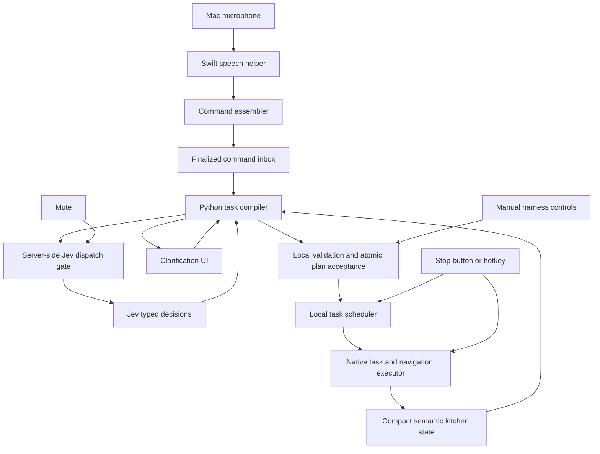

# Jev voice control flow design

Design agreed in the planning conversation and consolidated **6 November 2026**.
This document specifies proposed integration work, not completed functionality.
The current implementation baseline was inspected on this date; example kitchen
states and model outputs below are illustrative, not recorded game observations.
Configuration values described as starting points require measurement.

Navigation: [architecture](#1-purpose-and-accepted-decisions),
[Apple speech](#4-apple-speech-service-and-command-boundaries),
[mute and Stop](#5-mute-stop-and-manual-control),
[task compiler](#7-the-task-compiler),
[queues](#8-command-inbox-and-accepted-task-queue),
[schemas](#10-request-and-local-execution-schemas),
[clarification](#11-confidence-and-clarification),
[map and movement](#12-semantic-world-model-and-movement),
[six milestones](#15-six-implementation-milestones),
[verification](#16-verification-matrix-and-release-boundaries).

## 1. Purpose and accepted decisions

Integrate Apple's local speech recognition and Jev into the existing Python
harness so the user can direct Player 2 by voice while retaining all manual UI
controls. Jev interprets intent and chooses grounded options. Local code owns
scheduling, quantities, physical feasibility, navigation, interaction, recovery,
and proof of completion.

The accepted architecture is:



Core decisions:

- Keep recognition local; send command text and selected semantic state to Jev.
- Start muted. A server-enforced mute prevents all new Jev requests and retries.
- Keep manual controls, mute, and Stop operational without Jev.
- Use Choice and Noul for the initial command path. Score is optional later;
  Box and screenshots are not part of the initial integration.
- Maintain conversational context locally; each Jev request is self-contained.
- Compile commands into typed plans, with no unrestricted generated JSON or code.
- Discover successive task occurrences until an explicit `done`; do not require
  Jev to predict a task count first.
- Resolve arguments against task-specific contracts. Batch independent questions;
  stage dependent decisions across requests.
- Accept a multi-task plan atomically, after resolving all ambiguity.
- Execute separate tasks sequentially under one P2 control owner.
- Append ordinary commands by default when busy. Permit explicit interruption
  and queue edits; do not clear the queue automatically on every command.
- Support unlimited work as a task repetition policy, initially only at the tail
  of a sequence. Do not confuse unlimited execution with unlimited compilation.
- Add semantic regions and moving-platform groups. Jev can choose an area;
  native navigation chooses and verifies an actual route and arrival point.
- Implement and verify the six milestones in section 15, committing each
  significant completed milestone with the user's configured Git identity.

## 2. Current implementation and required additions

Relevant owning sources:

| Component | Current source | Current behavior / gap |
| --- | --- | --- |
| Speech prototype | [apple_speech_test.swift](../scripts/apple_speech_test.swift), [launcher](../scripts/test_apple_speech.py) | Uses progressive transcription; terminal/file tester, not a structured command service. |
| Harness bridge | [server.py](../harness/server.py) | Persistent connection, serialized game I/O, freshness checks, manual commands and Stop. No voice compiler or task queue. |
| Manual UI | [app.js](../harness/web/app.js), [index.html](../harness/web/index.html) | Existing task, interaction and navigation controls remain available. |
| Task client | [actions.py](../clients/actions.py) | Nine task families, typed arguments and native action entry points. |
| Native task contracts | [TaskRequest.cs](../src/Core/TaskRequest.cs), [TaskActions.cs](../src/Plugin/Actions/TaskActions.cs) | One active task, native child actions, completion receipts and recovery. |
| Client request identity | [control.py](../clients/control.py) | Numeric request counter restarts per connection; insufficient alone for durable deduplication. |
| Map view | [observation.py](../harness/observation.py), [HarnessCapture.cs](../src/Plugin/HarnessCapture.cs) | Projected visual geometry; not a reachability oracle or a semantic map. |

The nine task families currently include `assemble_dish`, `prepare_near_player`,
`take_ready`, `wash_dishes`, `deliver_dirty_dishes`, `put_out_fire`,
`toss_burnt_food`, `monitor_equipment`, and `deliver_completed_dishes`.

The original planning discussion predated the ninth task. As of this document,
[dish assembly](dish-assembly.md) handles one exact live ticket with explicitly
allocated bases, component instances and equipment. It can assemble prepared
components and perform recipe-derived mixing/cooking. It does not automatically
choose another order, chop ingredients, dispense replacement stock, wash a plate,
or serve the result. Assembly accepts exactly one repetition. The voice design
must expose these real boundaries instead of claiming either that all assembly
is absent or that unrestricted end-to-end recipe making is implemented.

Task eligibility currently disappears from `catalog.taskOptions` while P2 is
busy. Some task-specific data is also populated through idle discovery. Introduce
a read-only supported-capability and semantic-state interface independent of
whether P2 can start another job now. Do not cancel active work to discover
capabilities. Keep native start-time validation authoritative.

Existing lifecycle behavior must remain intact: focus loss, pause and temporary
input suppression suspend accepted work; browser reload and temporary socket
loss do not cancel it. Explicit Stop cancels it. Round changes and player
reassignment invalidate work for the old kitchen/chef. See [tasks](tasks.md),
[control lifecycle](control-lifecycle.md), and [navigation](navigation.md).

## 3. Responsibilities and data ownership

| Layer | Owns | Does not own |
| --- | --- | --- |
| Swift helper | Audio capture, Apple recognition, transcript ranges/revisions, microphone status | Hosted requests, game actions, task queue |
| Command assembler | Application command boundaries and one immutable utterance per submission | Guessing game intent from every partial transcript |
| Task compiler | Jev question generation, task occurrences, argument binding, clarification, plan validation | Button timing, physical route planning |
| Scheduler | Accepted queue, explicit edits, dispatch, reconciliation, terminal outcomes | Reinterpreting every game frame through Jev |
| Native executor | Live physics checks, cargo identity, actions, recovery and completion proof | Free-form language or hosted model calls |
| Harness UI | Shared status, manual controls, voice settings, clarification and queue editing | Sole enforcement of mute or stale-response rejection |

Use one serialized scheduler/coordinator for plan acceptance and queue changes.
Run Jev I/O in a separate worker/event loop; never hold the bridge's game I/O
lock or scheduler state lock across a model request. Keep the existing manual
harness usable when voice dependencies, recognition assets, or the network fail.

Suggested module boundaries (proposed names, not files already present):

```text
harness/voice/          helper lifecycle, events, command assembly, mute state
harness/capabilities.py versioned task contracts and native adapters
harness/decision/       Jev transport, context builder, question builders, compiler
harness/scheduler.py    single-writer queue and dispatch lifecycle
harness/semantic_map.py region/support graph and compact summaries
harness/plan_store.py   small local journal and recovery
```

A long-lived Swift helper is owned by Python, not by a browser tab. The Mac
microphone remains the source even when the harness is viewed on a phone. All
tabs observe the same global voice and queue state. Focus changes must not kill
the helper or an accepted task. Starting a voice result must not silently invoke
the existing UI-click behavior that foregrounds the game.

## 4. Apple speech service and command boundaries

The earlier [voice SDK investigation](thread://01a1aeb5-2266-7272-96bc-395ae62b7087?hostId=local)
established that Apple's phrase/passage results are not necessarily complete
sentences. Alternative transcriptions cover the same audio range and are ordered
by likelihood. Finalization means that audio's interpretation will no longer be
revised; it does not mean the user's complete instruction has ended.
[Apple result documentation](https://developer.apple.com/documentation/speech/speechtranscriber/result)

### 4.1 Configuration

| Setting | Initial policy |
| --- | --- |
| Provisional results | Display locally; never dispatch game work from them. |
| Alternative transcriptions | Enable; preserve range ownership and rank. |
| Result attributes | Request audio time ranges and transcription confidence. |
| `fastResults` | Expose as a setting and benchmark on/off. |
| Submission | Push-to-talk plus optional automatic pause endpointing. |
| Pause threshold | Start at 800 ms; compare 400, 800 and 1,500 ms. |
| Locale / input device | Select explicitly; report unsupported locale, missing assets and device loss. |
| Speech duration | Bound each command; explain overflow instead of truncating its meaning. |

The pause values are application settings to evaluate, not promised Apple
latencies. `fastResults` trades accuracy for responsiveness by reducing context.
[Apple option](https://developer.apple.com/documentation/speech/speechtranscriber/reportingoption/fastresults)

Apple exposes low/medium/high detector sensitivity, and the installed SDK has
`SpeechDetector.Result.speechDetected`. However, current public documentation
qualifies detector results as supporting error handling. Verify useful event
timing on the target OS before using this as the sole endpoint signal. Retain
push-to-talk and a local audio-based endpoint detector behind a replaceable
interface. Do not use transcript silence alone as proof that speech has stopped.
[Detector result](https://developer.apple.com/documentation/speech/speechdetector/result)

Vocabulary hints through `AnalysisContext.contextualStrings` are documented for
`DictationTranscriber`; do not assume they improve `SpeechTranscriber` without
evidence. Use the kitchen vocabulary in downstream interpretation regardless.
[Contextual strings](https://developer.apple.com/documentation/speech/analysiscontext/contextualstrings)

### 4.2 Assembly algorithm

1. Maintain audio timestamps, a short bounded local pre-roll where needed, and a
   speech-session generation. Device/format changes start a new generation.
2. Maintain an interval-based transcript buffer. Replace provisional overlapping
   results instead of appending every callback. Preserve finalized ranges.
3. Accumulate all chunks belonging to the current application command, even if
   Apple finalized an earlier phrase before the user finished speaking.
4. At push-to-talk release or a confirmed silence boundary, capture the exact
   input-audio cutoff. Continued speech belongs to a subsequent buffered turn.
5. Call `finalize(through:)` with that cutoff, avoiding `nil` when it would only
   finalize audio already consumed rather than the intended cutoff.
6. Coordinate the result consumer and finalization watermarks before taking the
   immutable transcript snapshot. A return from `finalize` alone is insufficient.
7. Emit exactly one command ID for that audio interval, or emit an empty/error
   event. Do not submit whitespace, cancelled turns or stale generations.

Apple says finalization can return before the app consumes published results.
It also permits unchanged provisional text to finalize without a replacement
final event. Therefore, do not wait only for a new `isFinal == true` callback.
Track consumed results and finalization progress, including analyzer range
changes; validate the synchronization protocol with captured event traces.
[Finalize API](https://developer.apple.com/documentation/speech/speechanalyzer/finalize%28through%3A%29),
[finalization watermark](https://developer.apple.com/documentation/speech/speechmoduleresult/resultsfinalizationtime)

A ten-second pause separates commands once the application has committed its
first cutoff. Previously committed words cannot be included again by a later
submission. Deduplicate by audio interval/command ID, not by text: repeating
"bring rice" intentionally must remain possible.

### 4.3 Helper event contract

Use versioned NDJSON over local pipes or an equivalent local-only IPC protocol.
Keep diagnostics on stderr; stdout carries structured events only. A transcript
event can use this shape (illustrative values):

```json
{
  "protocol_version": 1,
  "type": "transcript_update",
  "speech_generation": 4,
  "event_sequence": 91,
  "audio_range_ms": [1200, 2900],
  "finalized_before_ms": 2900,
  "text": "Give me two chopped carrots",
  "alternatives": ["Give me two chopped carrots", "Give me three chopped carrots"],
  "confidence_spans": [],
  "is_final": true
}
```

Also define `ready`, `device_changed`, `status`, `finalize_completed`, and `error`
events, and commands for arm, mute, finalize, configure and shutdown. Empty or
missing confidence metadata means unknown, never certainty. A finalization event
must identify its cutoff and generation; consuming it does not bypass the
result-consumer synchronization described above.

Retain alternatives per audio segment. Do not create the Cartesian product of
all phrase alternatives. Deduplicate identical strings and send a small bounded
set of material alternatives, initially up to three per relevant segment. Apple
may provide fewer; this cap does not request an exact number from Apple. Do not
invent probabilities from ranks. Low-confidence negations, quantities, ingredient
names and queue-edit terms deserve particular attention. Game feasibility may
help disambiguate speech, but must not silently rewrite an unavailable request
into a different available action.

## 5. Mute, Stop and manual control

The UI exposes **Mute voice / Jev off**, with the harness starting muted.
Enforce it in the Python dispatcher, not merely in JavaScript.

When mute is acknowledged by the server:

- No new Jev request may start, including retries, compilation stages, typed
  natural-language commands, clarification follow-ups or future automatic calls.
- Cancel in-flight requests where possible and invalidate all associated results.
- Drop unsubmitted utterances and unfinished voice drafts/clarifications.
- Stop microphone capture and discard buffered audio.
- Increment the voice generation; unmuting starts with fresh audio and no backlog.
- Keep manual structured controls operational without model calls.
- Preserve already accepted native work and the accepted task queue. These can
  continue deterministically while muted.

Request dispatch and mute must have a defined serialization point. Disabling SDK
automatic retries is necessary but not sufficient: every application retry also
passes the same gate. A request transmitted before mute cannot be unsent. The
guarantee is no dispatch after the server's mute acknowledgement and no execution
from a late unaccepted response. The UI must distinguish "muting" from an
acknowledged muted state; loss of connection must not falsely claim success.

**Stop** cancels the active native action, clears pending tasks and uncommitted
commands, invalidates late results, and prevents queued dispatch. It bypasses Jev.
The UI button and a local hotkey are the dependable paths. A narrow local voice
Stop recognizer may supplement them while armed; never trigger on a substring
such as "don't stop washing." Do not require hosted intent classification for
emergency stopping. Stop does not need to mute voice; a subsequent explicit
command can start new work.

"Clear queue" removes pending work only. "Pause queue" prevents future dispatch
without pretending that an active task has a general resumable pause checkpoint.
"Resume queue" resumes dispatch only after reconciliation and fresh validation.
These controls should have distinct labels and receipts.

Preserve current Host/Origin and token checks for new harness endpoints. Keep the
API key in the server environment/configuration, never in browser payloads.
Structured task clicks enter the same scheduler as voice. Existing immediate
controls should retain clearly labeled immediate behavior and suspend pending
dispatch when necessary; do not silently turn every existing click into append.

## 6. Capability contracts and typed plans

Publish supported capabilities independently of live start eligibility:

```text
implemented + startable now
implemented + temporarily blocked
implemented + applicability unknown
not implemented
```

Unknown route coverage is not proof of unreachability. Busy P2 is not proof that
washing is unsupported. Start eligibility is recomputed when an accepted task
reaches the front of the queue.

Each contract contains a version, semantic description, typed parameter schema,
required fields and explicit defaults, relevant candidate sources, repetition
unit and limits, start preconditions, completion evidence, cancellation behavior,
and whether checkpoint/resume is supported. Prefer one owning schema with
generated/adapted UI, compiler and client definitions over duplicated enums.
Native validation remains a separate authoritative boundary.

| Task | Semantic scope / contract notes |
| --- | --- |
| `prepare_near_player` | One item list per repetition; each entry has ingredient, preparation and quantity. Recipient is another eligible local player. |
| `wash_dishes` | One repetition is one washing batch, not one plate. |
| `deliver_completed_dishes` | One repetition is one verified dish delivery. |
| `monitor_equipment` | A standing assignment is supported; one finite iteration follows native task semantics. |
| Other existing tasks | Reuse their actual completion units from native code and [task documentation](tasks.md); do not infer counts from labels. |
| `assemble_dish` | One exact ticket and explicit allocation; exactly one repetition; serving is separate. |
| `move_to_region` | Proposed: reach a native-verified point inside a semantic region and idle. Not presently an exposed capability. |

Preparation currently accepts 1–10 entries, quantities 1–10, and repetitions
1–10 or unlimited. States are `raw`, `chopped`, `cooked`, `mixed`, and `empty`;
type membership alone does not make every ingredient/state combination feasible.
The compiler checks applicable native work chains. Map `until_cancelled` to the
existing client's `repetitions=None`; map finite repetition directly. Calculate
quantity products locally. Do not clamp out-of-range spoken quantities.

The compiled plan is a local discriminated union, not a Jev-generated blob:

```text
CompileResult = AcceptedPlan | ClarificationNeeded | Unsupported | NoChange

TaskSpec =
  NativeTask { action, validated_arguments, repeat }
  MoveToRegion { region_id, reference_frame, arrival_policy }

Repeat = Finite { count } | UntilCancelled

Plan = {
  schema_version, command_id, expected_queue_revision,
  queue_edit, tasks[], after_plan, on_failure
}
```

Validate task-specific fields, reject unknown fields, and enforce which union
branches support repetition. Each accepted task gets its own local stable ID.
Wire IDs and source bindings are resolved by an adapter; no model response can
name an arbitrary Python method or supply steering axes/buttons.

## 7. The task compiler

Compilation interprets language into a finite plan; execution performs that plan.
An unlimited task does not keep the compiler running indefinitely.

### 7.1 Discovery without a predicted task count

The baseline algorithm asks for the next task occurrence until Jev selects
`done`. Do not ask for a count `k` and make all later work depend on that answer.

Each discovery sees the original utterance, relevant alternatives/dialogue,
already interpreted occurrences, the next occurrence index, and capability
contracts. Its Choice options contain supported task families plus `done`,
`request_clarification`, and `unsupported`. A separate route handles queue-only
commands, corrections and no-change utterances before task discovery.

The instruction states: identify the next requested occurrence in intended
execution order; treat a correction as a revision, not an additional task; return
`done` only when all requested work has been represented. Never rely on a question
ID such as `task_2` to communicate the occurrence: include it in instructions.

Track occurrences, not a set of used task names. "Wash, bring rice, then wash
again" has two washing occurrences. Keep that task family available throughout.
Repeated task names are not a loop by themselves. Use a bounded discovery count,
semantic progress checks and a total request/deadline budget to stop mistakes.

### 7.2 Task-specific argument resolution

Once a family is selected, build a narrower context containing:

- The complete original utterance, corrections and material ASR alternatives.
- The specific task occurrence and already resolved earlier occurrences.
- That capability's contract and relevant parameters.
- Grounded ingredients, recipients, regions, tickets or allocation candidates.
- Any dialogue reference necessary to interpret "that," "again," or "the other."

Omit unrelated geometry, task internals and historical chatter. Do not remove the
original utterance merely because a task family has been selected: conjunctions,
negation and scope can affect argument meaning.

Resolve fields through Choice over allowed values or candidate spans, with
`unspecified` and `ambiguous` outcomes where appropriate. Extract numeric
candidates with local number parsing; Jev can bind a candidate to its intended
field. Code performs arithmetic. A default is allowed only when the contract
defines it and the omission is genuinely unambiguous. The client's raw-food
default is not permission to silently settle ambiguous speech as raw.

For preparation, identify item occurrences using the same bounded approach.
"One raw carrot and two chopped carrots" contains two entries, not one Boolean
carrot-presence flag. Resolve ingredient first if necessary, then batch independent
quantity, preparation and recipient questions with explicit occurrence scope.
Never ask a question to read a sibling answer in the same request.

For assembly, select an exact ticket from current grounded candidates. Build
candidate allocations locally from native recipe compatibility and resource
identities; Jev may select a meaningful allocation or resolve user preferences.
Do not ask it to perform recipe arithmetic or independently choose incompatible
resources. An accepted exact allocation is not silently replaced when stock
changes. If suitable allocation generation or missing upstream preparation is
unsupported, clarify or report that boundary rather than fabricate a full recipe
workflow. See [assembly's caller contract](dish-assembly.md).

### 7.3 Worked multi-task example

Utterance: "Give me two chopped carrots and one onion, then wash dishes."

1. Discovery selects preparation, occurrence 1.
2. Entry resolution identifies carrot/chopped/two and onion/unspecified/one.
3. If the preparation scope remains ambiguous, ask "Raw or chopped onion?"
   Preserve the draft, but make no queue mutation.
4. The user answers "chopped." Resolve only the pending field, with the original
   utterance and question still in context.
5. Next-task discovery selects washing, occurrence 2; its default is one batch.
6. Next discovery returns `done` with sufficient confidence and coverage.
7. Validate the complete plan and atomically accept it.

This yields two tasks, not three carrot/onion tasks and not one task per food
unit. The existing preparation executor owns the ingredient list.

### 7.4 Algorithm and stopping conditions

```python
async def compile_command(command, context):
    # Design pseudocode; helpers include gate, deadline and response validation.
    route = await resolve_command_route(command, context)
    if route.is_queue_only_or_non_action:
        return validate_route_result(route, context)

    draft = new_draft(command, context)
    while True:
        result = await choose_next_occurrence(command, draft, context)
        if result.is_clarification_or_unsupported:
            return draft.with_non_executing_result(result)
        if result.is_done:
            break
        if len(draft.tasks) >= context.max_task_occurrences:
            return clarification("Split this command into smaller parts", draft)
        task = await resolve_task_arguments(result.family, command, draft, context)
        if not task.is_resolved:
            return draft.with_non_executing_result(task)
        draft.append(task)

    draft.queue_edit = await resolve_queue_edit(command, draft, context)
    if not draft.queue_edit.is_resolved:
        return draft.with_non_executing_result(draft.queue_edit)
    validate_contracts_order_and_repeat_policies(draft)
    await verify_full_utterance_coverage_if_needed(command, draft)
    return validated_plan_or_clarification(draft, context)
```

Every awaited call consumes the same bounded compilation budget and checks mute,
generation and deadline. Do not execute the pseudocode's draft append as a game
queue append. Cap task occurrences initially at five and preparation entries at
the native limit of ten. The extra discovery after the fifth task may return
`done`; a sixth task requires clarification. Do not silently truncate on any cap.

Final validation checks required fields, supported combinations, quantities,
ordering, repeated occurrences, unlimited-task placement, referents and omission
of requested work. For complex commands, ask Jev a separate coverage question
with the actual assembled plan included in state. This can catch semantic errors
but is not independent proof of correctness. Local contract checks always apply.

### 7.5 Unlimited and conditional work

"Give me two chopped carrots, then keep washing" compiles into one finite
preparation request followed by `wash_dishes` with `until_cancelled`. Compilation
terminates normally; the second task's execution does not.

Initially allow at most one unlimited task, at the tail of a sequence. Reject or
clarify an append behind an existing unlimited task. "Keep washing, then bring
rice" cannot run as an ordinary sequence. Offer a finite batch followed by rice,
or an explicit replacement of the standing assignment.

"Wash while monitoring cookers" needs concurrent responsibility scheduling and
cannot be disguised as FIFO. "Do X until the wall closes" needs a supported
event-bound completion policy; it is neither automatically one repetition nor
forever. These are future contracts. Existing preparation/assembly may schedule
their own processing branches, but that does not grant concurrent ownership to
separate high-level jobs.

### 7.6 Latency optimizations after the baseline

Simple grounded commands can use one request with complete candidate plans.
Batch independent fields, and resolve independent parameters for already known
task occurrences together. Later evaluate speculative ordinal questions in one
request, with explicit `done`/coverage checks, against the baseline corpus.
Do not promise a fixed two-call interpretation: list extraction and ambiguous
commands can require several sequential decisions. Budget the whole transaction
and expose progress in the UI. Never trade silent omission for fewer requests.

## 8. Command inbox and accepted task queue

These are separate structures:

1. **Command inbox:** finalized utterances not yet accepted. Initially one active
   interpretation plus a small bounded pending inbox, e.g. three commands.
2. **Task queue:** validated, accepted work. Initially at most ten pending task
   entries, with one active native task outside that count.

Build fresh semantic state when a command reaches the front of the inbox. Do not
queue prebuilt old-world HTTP requests. Preserve normal command order: an
unconditional latest-utterance-wins policy would drop "bring rice" when followed
by "then wash." Explicit corrections, mute, Stop and round changes can invalidate
the relevant unfinished command. A correction arriving during interpretation
must be resolved against the command it supersedes, not blindly appended. If its
target has already executed, describe the actual state; never claim to undo it.

### 8.1 Queue operations

| Operation | Meaning | Typical language |
| --- | --- | --- |
| `append` | Add after existing work; start when idle. | "Wash dishes," "after that..." |
| `insert_next` | Insert after active task, before pending work. | "Do this next." |
| `replace_active` | Cancel active task, start new plan, preserve pending entries. | "Stop that and bring rice now." |
| `replace_pending` | Keep active task, replace pending entries. | "Replace what's queued with washing." |
| `replace_all` | Cancel active task and replace all pending work. | "Forget the plan; just wash." |
| `clear_pending` | Remove pending entries; leave active task running. | "Clear the queue." |
| `remove_pending` | Remove a specifically identified pending entry. | "Cancel the second queued task." |
| `stop_all` | Cancel active and pending work plus uncommitted commands. | "Stop." |
| `pause_pending` / `resume_pending` | Control dispatch, not a native checkpoint. | UI controls or explicit commands. |

Ordinary new voice work defaults to `append`; an immediate/deadline-sensitive
instruction may explicitly select interruption. Do not infer deletion of all
pending work from urgency alone. Ambiguous "instead" needs a scope decision or
clarification. Queue-only requests bypass task discovery. Jev can select these
operations, but the coordinator applies them and validates the scope. Destructive
queue edits require explicit intent evidence and a higher calibrated threshold.

Show the actual accepted effect: "Queued washing after rice" or "Stopped
washing; moving down. One pending task retained." For standalone repositioning,
`after_plan=pause_pending` prevents retained tasks from immediately moving P2
back. An explicit "move down, then wash" sequence continues as requested.

### 8.2 Dispatch and failure semantics

An accepted task can be `pending`, `waiting_to_start`, `dispatching`, `running`,
`waiting`, `suspended`, `reconciling`, `succeeded`, `failed`, or `cancelled`.
Native receipts distinguish terminal completion from waiting and suspension.

- Revalidate at dispatch; late-bind semantic requests only where the contract
  allows it. Exact object/ticket allocations retain their binding.
- Wait for verified success before dispatching the next dependent task.
- A blocked task is not completed. Preserve it and expose the reason; do not
  silently skip it to make the queue appear productive.
- On failure, pause pending dispatch by default. Keep pending entries visible.
- UI Skip is an explicit cancellation/advance operation, not a fake success.
- Cancellation for replacement waits for native cleanup/lease release before
  starting the replacement. Physical side effects already committed, including
  armed throws, cannot be rolled back.
- Do not automatically restart cancelled partial work. It may duplicate delivery
  quantities or lose resource reservations. General interrupt/resume requires
  explicit checkpoint support and remains out of initial scope.

Queue acceptance is one atomic revision-checked transaction. It is not an atomic
rollback of game effects. Validate the new plan before cancelling old work; if
fresh start conditions fail after cancellation, keep the new work visibly
waiting/failed rather than silently resurrecting the old task.

Store accepted plans, operation IDs and outcomes in a small local journal
(SQLite is sufficient). On process restart, start voice muted and reconcile the
native active/terminal receipt before advancing pending work. Unknown outcomes
pause dispatch. Browser reload alone does not reset the queue. A new level epoch,
bridge session or P2 assignment invalidates old kitchen-specific work.

## 9. Jev API and primitive selection

Use `POST https://api.typesafe.ai/v1/systemone`, with a server-side Bearer token,
JSON content type, and pinned model `jev-1.14.0`. Do not enable either the image
or long-context danger-zone header for this integration. The request envelope is
`model`, `state`, and `questions`; the response contains `model`, `answers`, and
`usage`. This is a typed-decision API, not an arbitrary tool-call generator.
[API reference](https://docs.typesafe.ai/api/system-one)

| Primitive | Returned values | Use in this design |
| --- | --- | --- |
| Choice | Selected key, probabilities, confidence | Task/entry occurrence, grounded target, parameter, queue operation, clarification category. |
| Noul | Probability that the proposition is true | Candidate coverage, explicit deletion intent, unresolved ambiguity and final plan coverage. |
| Score | Expected rubric level, distribution, confidence, legend | Optional later qualitative preference/urgency dimensions. Never extract counts or coordinates from a fractional score. |
| Box | Image-relative rectangle and confidence | Not used initially; native map observations are stronger grounding than image localization. |

Choice supports up to 255 options. Score uses ordered descriptions, with up to
ten levels, and can return values between levels. Noul has no separate confidence
field. Images/Box are currently experimental and do not certify navigability.
[Choice](https://docs.typesafe.ai/primitives/choice),
[Score](https://docs.typesafe.ai/primitives/score),
[Noul](https://docs.typesafe.ai/primitives/noul),
[Box](https://docs.typesafe.ai/primitives/box)

Jev requests do not retain conversation state. Keep a local context containing a
few recent accepted commands and outcomes, one pending clarification, current
assignment and queue, and explicit current-round preferences. Include only the
parts needed for this decision. Reusing the HTTP client does not provide model
memory. Do not send only a delta that depends on a previous request being
remembered. [Memory example](https://docs.typesafe.ai/cookbooks/basic_memory)

Questions within a request are evaluated independently against shared state.
Their IDs are application lookup keys, not instructions the model sees. Include
each occurrence and conditional scope explicitly in the question instructions.
Put shared candidate data in `state` when multiple questions need it. A companion
Noul cannot inspect another question's answer or privately supplied criteria.
[Evaluation model](https://docs.typesafe.ai/introduction),
[fan-out](https://docs.typesafe.ai/patterns/fan-out)

## 10. Request and local execution schemas

### 10.1 Shared decision state

This is an application schema inside Jev's `state`, not extra Jev API fields:

| Field | Content and rule |
| --- | --- |
| `schema_version` | `sous-chef.decision.v1` |
| `utterance` | Final text, ranked segment alternatives, uncertain spans; no audio. |
| `dialogue` | Relevant recent accepted turns/outcomes and optional pending clarification. |
| `scheduler` | Active task, compact pending queue, default edit policy. Include stable task aliases for edits. |
| `world` | Only relevant players, held cargo, regions, groups, stations, orders, hazards and known changes. |
| `capabilities` | Relevant supported contracts and applicability information, independent of busy state. |
| `compiler` | For staged calls: already interpreted task/item occurrences, current occurrence, resolved fields. |
| `candidate_plans` | For the simple-plan path: immutable grounded alternatives owned by a local registry. |

Different stages omit irrelevant optional fields. This is a projection of the
same authoritative local state, not a different hidden conversation. Each
request remains self-contained. Retain important corrections and negations in
the utterance even when a later stage's world context becomes much smaller.

The following local envelope is stored alongside the request and is **not sent
to Jev** merely for it to echo:

```json
{
  "command_id": "command_42",
  "decision_id": "decision_42_3",
  "voice_generation": 8,
  "cancellation_generation": 12,
  "bridge_session_id": "local-session-id",
  "level_epoch": 3,
  "player_assignment_revision": 1,
  "expected_queue_revision": 42,
  "capability_version": 1,
  "candidate_registry_version": 9,
  "topology_revision": 15,
  "decision_relevant_fact_ids": ["region_lower", "crossing_1"],
  "expires_at_monotonic": 12345.0
}
```

The coordinator validates this envelope and current facts before acceptance or
dispatch. A frame sequence change alone is not grounds to reject every decision.
Distinguish topology changes, target identity changes and harmless motion.

### 10.2 Complete simple-plan request

This example describes the **proposed** movement capability after implementation.
Until then, `move_to_region` must not appear as executable. Locations, active
tasks and observation evidence are synthetic examples.

```json
{
  "model": "jev-1.14.0",
  "state": {
    "schema_version": "sous-chef.decision.v1",
    "utterance": {
      "text": "Run to the bottom half now, before the wall closes.",
      "segments": [
        {
          "id": "segment_1",
          "alternatives": ["Run to the bottom half now, before the wall closes."]
        }
      ],
      "uncertain_spans": []
    },
    "dialogue": {"recent_turns": [], "pending_clarification": null},
    "scheduler": {
      "active": {"id": "task_17", "action": "wash_dishes", "scope": "one batch", "status": "running"},
      "pending": [{"id": "task_18", "action": "deliver_completed_dishes", "scope": "one dish"}],
      "default_queue_edit": "append"
    },
    "world": {
      "orientation": "top and bottom refer to the harness map",
      "players": [
        {"id": "p1", "region": "upper", "held": null},
        {"id": "p2", "region": "upper", "held": null}
      ],
      "regions": [
        {"id": "upper", "label": "upper half"},
        {"id": "lower", "label": "bottom half"}
      ],
      "connections": [
        {"from": "upper", "to": "lower", "access": "walk_now", "evidence": "native_route_check"}
      ],
      "anticipated_changes": [
        {
          "effect": "connection between upper and lower closes",
          "source": "current_user_utterance",
          "verified": false,
          "seconds_until_change": null
        }
      ]
    },
    "candidate_plans": {
      "move_lower": {
        "description": "Move P2 into the bottom half and idle there.",
        "tasks": [{"kind": "move_to_region", "region_id": "lower", "arrival_policy": "idle"}],
        "after_plan": "pause_pending"
      },
      "move_upper": {
        "description": "Move P2 into the upper half and idle there.",
        "tasks": [{"kind": "move_to_region", "region_id": "upper", "arrival_policy": "idle"}],
        "after_plan": "pause_pending"
      }
    }
  },
  "questions": {
    "disposition": {
      "type": "choice",
      "instructions": "Choose how to handle the utterance. Transcript alternatives are competing interpretations of one command, not separate commands.",
      "criteria": {
        "execute": "The intended work is clear and represented by a candidate plan.",
        "request_clarification": "The intended work, target or scope remains ambiguous.",
        "unsupported": "The intended work is clear but no candidate represents it.",
        "no_change": "The utterance requests no new work or change."
      }
    },
    "plan": {
      "type": "choice",
      "instructions": "Which candidate matches the requested movement? Judge the destination independently of queue scheduling.",
      "criteria": {
        "move_lower": "Move into the bottom half and idle there.",
        "move_upper": "Move into the upper half and idle there."
      }
    },
    "candidate_set_covers_request": {
      "type": "noul",
      "instructions": "Does at least one candidate_plans entry cover all requested work, excluding when it should be scheduled?",
      "criteria": {
        "true": "A supplied plan represents the complete requested work.",
        "false": "Every supplied plan omits, changes or invents requested work."
      }
    },
    "queue_edit": {
      "type": "choice",
      "instructions": "Which scheduling change is requested? Use append when unspecified. Interrupting active work does not imply deleting pending work.",
      "criteria": {
        "append": "Add after existing work.",
        "insert_next": "Run after the active task, before pending work.",
        "replace_active": "Cancel active work and run now; preserve pending work.",
        "replace_pending": "Keep active work; replace pending work with this plan.",
        "replace_all": "Cancel active work and replace all pending work with this plan.",
        "request_clarification": "The scheduling change is ambiguous."
      }
    },
    "pending_deletion_requested": {
      "type": "noul",
      "instructions": "Does the utterance explicitly request discarding previously queued pending work?",
      "criteria": {
        "true": "It asks to forget, clear or replace previously queued work.",
        "false": "It requests new work or interruption without discarding pending work."
      }
    }
  }
}
```

The candidate-set Noul protects against a Choice always producing a best option
even when none fits. Conflicting answers do not authorize execution. For example,
`replace_all` with weak deletion evidence becomes clarification. If the simple
candidate set omits a task that exists in the full registry, fall back to staged
compilation instead of claiming global lack of support.
[Companion Noul](https://docs.typesafe.ai/patterns/companion-noul)

### 10.3 Staged discovery and field questions

A discovery request uses the same envelope, with `compiler` state such as:

```json
{
  "already_interpreted": [
    {
      "occurrence": 1,
      "action": "prepare_near_player",
      "resolved_meaning": "Give P1 two chopped carrots and one chopped onion."
    }
  ],
  "next_occurrence": 2
}
```

Generate its question from the full supported registry. The following is a
question fragment, not a complete HTTP body:

```json
{
  "next_task": {
    "type": "choice",
    "instructions": "Identify task occurrence 2 in intended execution order after compiler.already_interpreted. Use the original utterance and resolved clarifications. Corrections revise an occurrence; they are not extra tasks. Choose done only when all requested work is represented.",
    "criteria": {
      "prepare_near_player": "Prepare the requested item list and give it to another player.",
      "assemble_dish": "Assemble one identified live ticket using explicit allocated resources; serving is separate.",
      "wash_dishes": "Collect and wash a batch of dirty dishes.",
      "take_ready": "Take ready food off heat using the supported task.",
      "deliver_dirty_dishes": "Deliver dirty dishes to the receiving player when the task's native conditions apply.",
      "put_out_fire": "Extinguish observed reachable fires using the supported task.",
      "toss_burnt_food": "Dispose of ruined food and handle the surviving utensil.",
      "monitor_equipment": "Monitor unattended processing equipment and collect ready output.",
      "deliver_completed_dishes": "Serve completed dishes matching live orders.",
      "done": "All requested task occurrences have already been represented.",
      "request_clarification": "The next occurrence or its ordering is ambiguous.",
      "unsupported": "The next requested work has no supported task contract."
    }
  }
}
```

This registry snapshot deliberately omits unimplemented movement. Add movement
only when its capability is available. Maintain full relevant task-family recall;
do not filter out washing merely because another task currently owns P2.

After identifying a carrot entry, an independent parameter batch could contain:

```json
{
  "preparation": {
    "type": "choice",
    "instructions": "Which preparation state is requested for task occurrence 1, item occurrence 1, identified as carrot? Resolve the actual requested state, not whichever is easiest to execute.",
    "criteria": {
      "raw": "Explicitly raw or unprocessed carrot.",
      "chopped": "Chopped carrot.",
      "unspecified": "No preparation state is specified for this entry.",
      "ambiguous": "More than one preparation interpretation remains plausible."
    }
  },
  "quantity": {
    "type": "choice",
    "instructions": "Which supplied quantity candidate applies to task occurrence 1, item occurrence 1, identified as carrot? Respect corrections.",
    "criteria": {
      "one": "One unit.",
      "two": "Two units.",
      "three": "Three units.",
      "unspecified": "The quantity is not stated.",
      "ambiguous": "The quantity cannot be resolved from the utterance."
    }
  }
}
```

The example candidate quantities and states are illustrative. Generate them from
actual utterance candidates and the contract, retaining an out-of-range outcome
when necessary; never omit a spoken value and force it to a smaller allowed one.
More dependent fields are resolved in subsequent requests. Structured
instructions/criteria are allowed, but start with direct wording and few hops.
[Structured criteria](https://docs.typesafe.ai/primitives/advanced),
[function calling pattern](https://docs.typesafe.ai/cookbooks/function_calling),
[list extraction pattern](https://docs.typesafe.ai/cookbooks/cart_from_primitives)

### 10.4 Response validation and local output

Consume Choice fields `type`, `choice`, `probabilities`, `confidence`, and Noul
fields `type`, `noul`, under the expected question names. Check types, finite
values, ranges, required fields, and membership in the exact sent criteria.
Missing critical evidence is not a successful answer. Record returned model and
usage. Do not execute a reconstructed model description; look up the selected
key in the immutable local registry associated with this request.

After the onion clarification in section 7, the local plan can be:

```json
{
  "schema_version": "sous-chef.plan.v1",
  "command_id": "command_42",
  "expected_queue_revision": 42,
  "queue_edit": "append",
  "tasks": [
    {
      "task_id": "task_43",
      "kind": "native_task",
      "action": "prepare_near_player",
      "arguments": {
        "player_id": 1,
        "items": [
          {"ingredient": "carrot", "preparation": "chopped", "quantity": 2},
          {"ingredient": "onion", "preparation": "chopped", "quantity": 1}
        ]
      },
      "repeat": {"kind": "finite", "count": 1}
    },
    {
      "task_id": "task_44",
      "kind": "native_task",
      "action": "wash_dishes",
      "arguments": {},
      "repeat": {"kind": "finite", "count": 1}
    }
  ],
  "after_plan": "continue_pending",
  "on_failure": "pause_pending"
}
```

The adapter converts repetition policy to native arguments. Replacing the final
task's repeat object with `{"kind":"until_cancelled"}` represents "then keep
washing." It is legal only if no work would become stranded behind that task.
The whole plan is local construction; Jev never supplies executable method names
outside registered choices.

## 11. Confidence and clarification

Clarification is an ordinary non-executing compiler result. It may originate
from an explicit Jev choice or a local veto due to uncertainty, unsupported
parameters, missing referents, contradictory answers or stale necessary facts.
No partial plan is executed while a compound request awaits clarification.

For Choice, primarily inspect `probabilities[choice]` and relevant competitors.
Jev's confidence is derived from the distribution, not additional independent
evidence; at fixed option count it transforms the top probability. Do not
multiply confidence, Choice probability, coverage Noul and Apple confidence
into an allegedly calibrated joint success probability. Score confidence has
different ordered-level semantics. Neither is a guarantee of correct intent.
[Confidence](https://docs.typesafe.ai/confidence)

Starting evaluation settings, **not validated production thresholds**:

| Decision | Starting gate |
| --- | --- |
| Ordinary task, target and required field | Selected probability at least 0.90. |
| Deletion/replacement scope or disposal target | At least 0.97 plus explicit scope evidence. |
| Candidate/full-plan coverage | Strong positive Noul, initially at least 0.90. |
| `done` and unlimited-repeat choice | Treat as critical semantic decisions; low certainty cannot silently stop extraction or start forever. |

Calibrate each family, including important ASR disagreement cases, against held-out
commands. Inspect close competing meanings rather than blindly applying a single
global number. Unknown ASR confidence stays unknown. World feasibility cannot
overrule a clear request for something currently unavailable.
[Probability-based routing](https://docs.typesafe.ai/patterns/probability-routing)

Use local templates for concise clarification, optionally selecting a template
category with Choice. Examples: "Rice or fries?", "Raw or chopped onion?", "Do
this now or after washing?", and "Clear pending work or stop everything?" Jev
does not need to generate prose. Show clickable answers and allow spoken answers.

A pending clarification stores its ID, command/draft, unresolved field, options,
question text, originating queue revision and expiration. Interpret "chopped"
against that record. Distinguish an answer, correction, cancellation and an
unrelated new command. Do not let a late "yes" answer an expired question.
Mute, Stop and round changes invalidate it. A manual edit or material state
change requires revalidation before committing the completed draft. Existing
accepted work continues unless explicitly stopped.

## 12. Semantic world model and movement

### 12.1 What crosses the network

| Send when relevant | Keep local |
| --- | --- |
| Final text, material alternatives and uncertain spans | Raw microphone audio and recordings |
| Current assignment, progress summary and pending tasks | Every internal action step and diagnostic |
| A few relevant prior turns and clarification | Unbounded transcript/history |
| Supported contracts and grounded candidates | Source code, full implementation schemas unrelated to the task |
| Player regions, held cargo and important stations | Every Unity object, instance field and prefab |
| Relevant orders, available stock and computed urgency | Unfiltered order/history streams |
| Regions, current connections, moving groups and hazards | Meshes, collider triangles, individual tiles and navigation nodes |
| Known future changes with evidence labels | Assumed schedules or invented raft arrival times |

Semantic aliases can reference actual objects through a local registry. Avoid
unnecessary native IDs and OS details; credentials, filesystem paths and browser
tokens never belong in state. Cache local map summaries and update on meaningful
changes. A new utterance triggers a fresh projection, not a new full scene scan.
No steady 5/20 Hz stream is sent to Jev. Accepted tasks continue using local code
between commands; initial integration does not repeatedly ask Jev to reconsider
every waiting state. Future automatic reconsideration requires an explicit
policy and the same mute/rate/deadline gates.

### 12.2 Regions, supports and motion groups

Build a graph of semantic regions and connections. Keep height layers separate,
retain holes, and distinguish ground regions from moving support identities.
The current visual projection cannot certify any edge; native navigation must
provide reachability evidence, including partial/unknown coverage and direction.

Group moving components by native motion controller/support ownership and
hierarchy. Correlated motion can supplement evidence, but two objects sharing a
velocity are not necessarily one raft. Aggregate attached station summaries and
occupants. Stable IDs live within a level epoch; current labels such as "left
raft" can change as geometry moves, so clarify ambiguous crossing labels.

Representative grouped state (station counts are fictitious):

```json
{
  "moving_groups": [
    {
      "id": "platform_a",
      "kind": "moving_platform",
      "label": "left raft",
      "occupants": ["p2"],
      "stations": {"chopping_board": 2, "ingredient_supply": ["rice"]},
      "motion": {
        "state": "moving",
        "toward": "left_bank",
        "evidence": "observed_motion",
        "arrival_seconds": null
      }
    },
    {
      "id": "platform_b",
      "kind": "moving_platform",
      "label": "right raft",
      "occupants": ["p1"],
      "stations": {"cooker": 2},
      "motion": {
        "state": "unknown",
        "toward": null,
        "evidence": "insufficient_observation",
        "arrival_seconds": null
      }
    }
  ]
}
```

This is how a two-raft kitchen can be described without listing every moving
tile. It is not a verified inventory of story 3-1. Use the same general grouping
for other moving kitchens rather than a level-name allowlist.

Connection access can distinguish `walk_now`, `wait_for_connection`,
`supported_transfer`, `unreachable`, and `unknown`. A hypothetical future
connection is not immediate execution permission. Riding/boarding a platform
requires an actual supported executor policy and native transition checks.
Summarize P1 access separately where necessary; P2 reachability does not prove
the receiving player can collect an item.

Future changes carry source and freshness: `native_phase`, `observed_cycle`, or
`user_report`, for example. Treat an observed cycle as a forecast, not certainty.
Unknown times remain null. Code computes timing/travel comparisons; Jev chooses
intent and strategy from the resulting facts.

### 12.3 "Run to the bottom half"

Add `move_to_region(region_id, reference_frame, arrival_policy)` as a native-backed
capability. Define top/bottom/left/right in the same orientation as the harness
map and expose that convention. Do not silently assume world axes match the game
camera; verify or explicitly label the difference. Region extraction should use
playable supports/topology, not a naive bounding box that includes scenery.

1. Code supplies region choices, player membership and current connectivity.
2. Jev chooses the intended area or an allowed candidate satisfying "opposite
   side from me." Code computes the relationships and possible outcomes.
3. Code generates safe interior arrival candidates on the correct support/layer,
   with local clearance, hazard and route checks.
4. Native navigation executes and revalidates as geometry changes.
5. Completion proves actual membership in the intended region with appropriate
   tolerance/stability, not arrival at an obsolete world coordinate.

Use a support-local reference for "onto that raft" and a map-region reference
for "bottom half." If a region splits or disappears, rebind only when its intent
remains unambiguous; otherwise wait or clarify. Pending region IDs must not
silently change meaning after topology revision.

Standalone repositioning arrives and idles, pausing preserved pending dispatch.
An explicit subsequent task can continue. "Stay on the bottom and handle dishes"
requires a persistent regional constraint enforced by task selection and native
navigation; implementing arrival alone does not fulfill that request. Add it
after the first movement capability and advertise it separately.

## 13. Runtime consistency, recovery and performance

### 13.1 Stale results and task identity

Before accepting a result, check mute/generation, command validity, model/schema,
candidate registry, queue revision, bridge session, level epoch, player assignment,
deadline, and decision-relevant facts. Revalidate physical prerequisites again
immediately before native dispatch. Do not discard every result just because
moving geometry updated a frame; preserve semantic bindings and use live checks.

Queue edits use compare-and-swap against their originating revision. A concurrent
manual change must not be overwritten by a late response. A pure append may be
rebased only if its meaning and dependencies are unchanged; otherwise rebuild
context or clarify. Revisions for material queue edits should be distinct from
routine progress updates so progress alone does not cause starvation.

Use stable unique native request IDs, such as 32 hexadecimal characters, within
the existing 32-character grammar. Extend the client to supply them. Add a bounded
receipt/deduplication facility: same ID and payload retrieves the same outcome;
same ID with different payload is rejected. Bind receipts to the kitchen epoch.
Existing request IDs provide correlation, not this guarantee by themselves.

Journal dispatch intent before sending, then record acknowledgment/terminal
evidence. If the socket drops after acceptance, query the receipt and adopt the
existing task. Never blindly replay a pickup, throw or partially completed task.
If the bridge cannot prove an outcome, mark reconciling and pause subsequent
dispatch. Do not claim exactly-once physical effects merely because HTTP or TCP
was retried.

### 13.2 Timeouts, retries and service failure

Use a persistent asynchronous Jev client in a dedicated worker. Disable SDK
automatic retries (`RetryPolicy(max_retries=0)`) and own retries in the dispatcher
so mute and command deadlines apply to every attempt. Use a bounded total
compilation deadline as well as per-request timeouts; values are benchmarked
configuration, not implicit unlimited waits. Retry transient overload/rate/network
failures only while current, respecting retry hints and backoff. Do not retry
authentication/schema failures unchanged. A token overflow needs context repair,
not identical replay. A completed old decision must not become executable after
the network recovers. [Async client](https://docs.typesafe.ai/sdk/python/api/clients/async),
[retries](https://docs.typesafe.ai/sdk/python/api/retries),
[errors](https://docs.typesafe.ai/api/errors)

Use a priority control path for Stop and mute. They must not wait for model I/O
or an entire queued compilation. Native stop must remain available when a normal
bridge command is waiting on I/O. Preserve the executor's input neutralization,
outcome checking and suspension semantics. On pause/focus loss, accepted work
stays suspended; voice may be buffered locally, but stale or deadline-sensitive
commands must not unexpectedly fire much later. Initial policy: no native dispatch
while suspended, with explicit UI status and command freshness revalidation.

Interpretation expiry is separate from accepted task lifetime. Existing native
tasks can wait indefinitely. Do not introduce hidden task deadlines merely
because a model request has a timeout. If the user requests a timed task, require
a contract that actually implements it.

### 13.3 Audio, UI and observability

Handle microphone permission denial, asset download, unsupported locale, sample
rate conversion, device loss and helper crash as visible states. Start no network
work on stale helper output. Keep a single recognizer loaded where practical;
measure CPU, memory and frame-time contention while the game runs.

Continuous listening can capture conversation or game audio; push-to-talk is the
initial dependable mode. Add an optional explicit activation policy for hands-free
mode and test false activation. If synthesized acknowledgments are added later,
prevent them from feeding back into recognition. Start with on-screen status and
local templates; TTS is not required for this design.

UI states include muted, preparing recognition, listening, finalizing,
interpreting, clarification needed, accepted/queued, executing, waiting,
suspended, and error. Show current transcript, accepted interpretation, active
task, pending tasks, and last outcome. Add queue append/run-now/edit controls,
preview mode, mic settings and a prominent independent Stop button.

Log local correlation IDs, timings, model version, token usage, selected keys,
decision distributions, validation failures, queue mutations and native receipts.
Keep raw audio recording off by default; opt-in evaluation recordings are separate
from normal operation. Bound transcript/debug retention and redact secrets.
Do not enable verbose SDK body logging by default: request bodies contain user
speech and game state. User-facing UI uses plain descriptions; internal generations
and schema versions belong in diagnostics.

## 14. Context and request budgets

Default Jev limits are 64,000 tokens per request and 32,000 per question:

```text
S + sum(Q_i) <= 64,000
S + Q_i      <= 32,000  for every question i
```

Here `S` is shared state and `Q_i` includes that question's instructions/options
and applicable encoding overhead. State counts once in each calculation. A
30,000-token state leaves only about 2,000 for each question, even if the total
request fits. Keep extended context disabled. [Models and limits](https://docs.typesafe.ai/models)

Initial application targets:

- Ordinary state roughly 1,500–4,000 tokens, usually below 8,000 total per call.
- Prefer a few dozen meaningful choices over hundreds of combinatorial plans.
- Small task-specific projections for parameter calls.
- Five task occurrences, native preparation-entry limits, bounded inbox/queue,
  and an explicit total request/time budget per compilation.
- Bound total calls as well as individual payload size: a tiny looping request
  is still a latency/cost failure.

Track actual usage per request and total usage per user command. Use a compatible
tokenizer if provided; otherwise use a conservative estimator with large margin
and handle server limit errors. Do not assume another model's tokenizer gives
an exact Jev count. JSON compression changes transport size, not token semantics.

When a request is too large, project out irrelevant history, distant stations,
duplicate alternatives and unrelated contracts; stage dependent decisions rather
than expanding the Cartesian product. Do not trim away negation, unresolved
alternatives, required queue scope or necessary safety facts. Keep task-family
coverage sufficient to avoid declaring an implemented task unsupported.

TypeSafe documents weaknesses in arithmetic, indirection, unrelated context and
option-order sensitivity. Compute counts/deadlines/route costs locally, use direct
semantic descriptions, and reorder options in offline evaluations. Treat command
text as data, including utterances that try to alter the compiler's rules; fixed
contracts and local validation remain in control.
[Model limitations](https://docs.typesafe.ai/model-jaggedness)

## 15. Six implementation milestones

Each milestone ends with a scoped local commit using the user's Git identity,
without co-authors, and records what was actually verified. Preserve unrelated
workspace changes. There is no automatic push or deployment implied.

### Milestone 1 — Shared capability contracts

Deliver:

- Versioned contracts for all currently implemented task families and supported
  navigation/interaction adapters, including assembly's exact allocation limits.
- Separation of supported capability, applicability, and start eligibility.
- Read-only semantic catalog access while P2 is busy, without moving objects or
  cancelling its job.
- Typed plan/argument validation, repetition units and capability version checks.

Acceptance: the UI/compiler registry matches the native client contracts;
unsupported fields and illegal combinations are rejected; busy/suspended P2 does
not erase supported tasks; no guessed feature is advertised as executable.

### Milestone 2 — Local scheduler and harness UI

Deliver:

- One active task plus bounded pending queue, explicit queue edits, revision
  checks, and atomic plan acceptance shared by manual and future voice commands.
- Stable command/task IDs, receipt reconciliation and deduplication support.
- Queue journal, reload/restart recovery, explicit waiting/failure policies.
- UI Add, Run now, remove/reorder where supported, clear pending, pause/resume
  dispatch and Stop; finite/unlimited tail validation.

Acceptance: multi-step plans run in order only after verified success; lost
acknowledgments do not replay accepted work; Stop cancels dispatch and late work;
unknown outcomes pause the queue; existing pause/reconnect behavior is preserved.
Reordering must preserve explicit dependencies or ask the user to replace the plan.

### Milestone 3 — Apple speech service

Deliver:

- Persistent structured Swift helper with alternatives, range/confidence metadata,
  lifecycle/error events and input-device/locale settings.
- Application command assembler with push-to-talk and configurable endpointing.
- Global server-side mute generation/gate and UI status, initially exercised with
  a fake model transport; startup is muted.
- Local transcript inspection without accidental remote requests.

Acceptance: provisional revisions and finalization watermarks produce one command
per intended turn; long pauses separate turns; mute flushes audio/unsubmitted
commands; device failure cannot submit stale audio. Measure endpoint timing with
real microphone input and game sound, not only generated test audio.

### Milestone 4 — Jev interpreter

Deliver:

- Pinned Jev adapter, bounded timeout/retry logic, request/response validation.
- Simple candidate-plan path and staged occurrence-based task compiler with
  argument resolution, unlimited policies and whole-plan coverage checks.
- First-class clarification templates/buttons/spoken responses and expiration.
- Explicit queue-operation interpretation and local scope/confidence validation.
- Preview mode displaying the proposed plan and mutation without executing it.

Acceptance: representative single/multi-task commands compile correctly;
ambiguous or unsupported commands cause no partial execution; repeated task/item
types survive; mute blocks later stages and retries; manual edits defeat stale
results; confidence thresholds are evaluated on held-out examples. Enable actual
automatic acceptance only after these checks, with clear mode indication.

### Milestone 5 — Semantic map and movement

Deliver:

- Region/support/connection graph with explicit orientation, evidence and unknowns.
- Moving-platform aggregation with station and occupant summaries.
- Native-backed `move_to_region` candidates and arrival-and-idle execution.
- Standalone repositioning pauses preserved pending dispatch; explicit subsequent
  tasks continue. No invented physics, closure times or platform rides.

Acceptance: bottom/opposite-side commands reach the intended supported region;
moving supports retain identity; blocked/unknown routes never become fabricated
permission; geometry changes cause safe revalidation; map extraction stays
bounded and does not materially degrade gameplay frame times.

### Milestone 6 — Evaluation and broader capabilities

Deliver:

- Reproducible transcript/ASR event corpus, model decision fixtures, scheduler
  race tests and native replay scenarios, with recorded versions and results.
- Measurements of intent correctness, omission/false-action rate, clarification
  rate, per-stage and end-to-end latency, token cost and sustained game overhead.
- Tuned endpoint and confidence settings using separate evaluation examples.
- A prioritized extension plan for persistent regional assignments, safe task
  checkpoints/resumption, background responsibilities and new high-level tasks.

Acceptance: first usable release covers manual control, mute, clarification,
finite/multi-task plans, terminal unlimited work, current supported high-level
tasks and semantic repositioning. Broader responsibilities are enabled only as
their contracts and executors are implemented and tested; they are not required
to be silently approximated to declare the initial integration usable.

## 16. Verification matrix and release boundaries

| Area | Required scenarios / evidence |
| --- | --- |
| Transcript assembly | Overlapping revisions, multiple finalized chunks in one command, no replacement final event, finalize/result-consumer race, long pause, device generation change, repeated identical commands. |
| Language | Negation, "two—actually three," rice/fries alternatives, ambiguous adjective scope, pronouns, corrections, unrelated speech, requested task missing from shortlist. |
| Multi-task plans | Repeated task types, repeated ingredient with different preparation, ordering, list caps, low-confidence `done`, omitted later task, finite quantities versus repetitions. |
| Unlimited work | Unlimited tail accepted, following work rejected/clarified, append behind active forever rejected, unsupported concurrent/conditional duties not serialized incorrectly. |
| Clarification | No partial dispatch, original context retained, answer versus new command, expiry, stale options, manual queue mutation, Stop/mute invalidation. |
| Mute | During capture, finalization, model transport, between stages and during backoff; late result rejected; no replay on unmute; typed language cannot bypass Jev-off. |
| Scheduler | Append/insert/replace/clear scopes, revision conflicts, capacity, native busy cleanup, waiting not success, failure pauses dependent tasks. |
| Identity/recovery | Socket loss before/after acceptance, duplicate IDs, conflicting ID payload, process restart, missing terminal receipt, level reset, expired exact ticket. |
| Lifecycle | Browser reload, unfocus, pause, respawn, reassignment; existing accepted-job persistence maintained. |
| Map/movement | Opposite-side reasoning, orientation, split/merged regions, moving platform labels, separate decks, stale safe points, incomplete reachability, unknown closure times. |
| Provider | Timeout, 429/overload, auth/schema errors, missing/malformed answers, token overflow, bounded retry, model-version drift. |
| Performance | Warm/cold ASR, helper memory, CPU pressure, game frame-time p50/p95, sustained motion-heavy kitchens, network stage timings and request counts. |

Use fake transports to verify scheduling and mute deterministically, labeled
transcripts for compiler evaluation, opt-in local audio recordings for ASR, and
existing native-headless tooling for actual task and navigation behavior.
UI verification should cover desktop and the existing phone view. No passing
mock test establishes correct native interaction or microphone performance.

Measure last audible speech sample → immutable command → completed interpretation
→ queue acceptance → native start → verified outcome separately. Endpointing,
network, compilation call count and waiting behind accepted work are different
latency sources. A slow queue is not necessarily slow recognition.

Do not benchmark by permitting ambiguous commands to execute. Preview mode and
fixtures establish expected interpretation first. Report false actions and
omissions as well as average accuracy; an apparent reduction in clarification
rate is not an improvement if it increases wrong actions.

## 17. Source and implementation notes

The accepted task-compiler follow-up supersedes the earlier tentative four-task
limit with a proposed five-occurrence cap. Both the cap and queue capacity are
configuration choices, not Jev limits. The initial queue default remains append,
with explicit interruption and deletion scopes. General resumable preemption,
concurrent responsibilities, persistent area constraints and event-bound tasks
remain separate work.

The current repository and provider sources, rather than older research notes,
own changing capability facts. See also [AI stack research](ai-stack-research.md),
[local ASR research](on-device-asr.md), [harness](harness.md), and
[native simulator](native-simulator.md). Their historical recommendations and
validation results do not establish latency or correctness for this new flow.

This design does not require a second generative model, cloud audio, image input,
extended context, hosted conversation sessions, autonomous continuous replanning,
or TTS to ship its first usable version. Revisit those only when an evaluated
need cannot be met cleanly by the bounded compiler and native task contracts.
