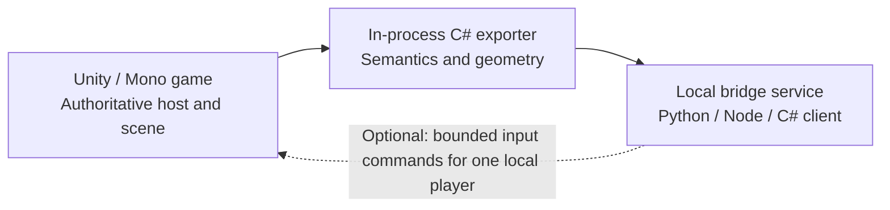

# Overcooked! 2 bridge investigation

*Live state and player control — installed Mac build inspected October 29, 2026.*

Markdown edition of the original 12-page investigation. Findings, estimates and source versions retain the original investigation date.

[Original PDF](</Users/henryyang/Documents/Codex/2026-10-29/applications-overcooked-2-app-can-you-6/outputs/overcooked2-bridge-investigation.pdf>) · [Companion evidence JSON](</Users/henryyang/Documents/Codex/2026-10-29/applications-overcooked-2-app-can-you-6/outputs/overcooked2-investigation-evidence.json>)

## 1. A practical bridge is feasible

Installed Mac build inspected on October 29, 2026. This report combines local binary and asset inspection with primary-source mod research. Findings apply to this installed version; they are not a claim of live bridge compatibility.

### The decision

**Proceed with a small in-process C# plugin, starting with read-only observation.** The installed game uses Unity 2017.4.8f1 and Mono, exposes readable gameplay code, and contains explicit systems for the requested mechanics. A Python or Node client can consume a local state stream. Player input is also feasible through the game's existing input abstractions.

| Question | Finding |
| --- | --- |
| Does the supplied app contain the game? | No. It is a 2.47 MB Steam shortcut with three files. The real game bundle is 8.57 GB (7.98 GiB) inside the Steam library. [L1-L2] |
| Can a bridge expose rich live state? | High feasibility for local play or the hosting machine. Gameplay objects, recipes, processing progress, physics, geometry and environment controllers are available in the process. [L3-L6] |
| Is all-level completeness automatic? | No. It requires adapters, scene traversal, event tracking and a representative level test suite. An entity-registry dump alone misses geometry and some environmental behavior. [L4-L6] |
| Can it control a chef? | High feasibility. Logical stick/button interception and an in-game virtual gamepad both have concrete source precedents. Mac loading and exact input behavior remain untested. [S1-S4] |
| Can it perfectly save, rewind or predict everything? | That is a substantially larger task. Engine physics internals, coroutine locals, animation transitions, RNG use and network scheduling are separate from exporting current gameplay state. |

### What was actually verified

Inspected the launcher and actual installation; decompiled both main gameplay assemblies; indexed 3,960 managed type definitions; parsed the bundle manifest and three scene bundles; traced core mechanics and external save storage; reviewed two bridge projects and a general mod framework. No game files, saves or Steam settings were changed. No mod was installed and no live bridge was run.

## 2. Where your game actually lives

### The app you supplied is a launcher

```text
/Applications/Overcooked! 2.app
```

Its only files are an Info.plist, an icon and Contents/MacOS/run.sh. The script launches **steam://run/728880**. Its total logical file size is 2,466,141 bytes; the icon accounts for nearly all of it. Copying this app would copy a shortcut, not the game. [L1]

### The real application bundle

```text
/Users/henryyang/Library/Application Support/Steam/steamapps/common/Overcooked! 2/Overcooked2.app
```

This is a directory displayed by Finder as an app. It holds 8,566,091,528 bytes. Steam's installed manifest reports app 728880, build 20236421 and Mac depot 728883. [L2]

| Inside the real app | Role |
| --- | --- |
| Contents/MacOS/Overcooked2 | 32.7 MB native x86_64 Unity executable. This is the engine/player binary, not a standalone copy of all assets. |
| Contents/Resources/Data/Managed | 60 managed DLLs. Assembly-CSharp.dll is 2.71 MB and has 3,465 type definitions; Assembly-CSharp-firstpass.dll is 0.40 MB and has 495. |
| Contents/Resources/Data/StreamingAssets/OSX | About 8.20 GB. The manifest lists 467 asset bundles, including scenes, shared resources and content with DLC names. Presence does not establish ownership/unlock status. |
| resources.assets, sharedassets*, globalgamemanagers | Shared assets, startup configuration and Unity metadata. The game is not contained in Assembly-CSharp.dll alone. |
| Contents/Frameworks and Contents/Plugins | Embedded Mono and native integrations, including Steam and Galaxy libraries. |

### Files and state outside the bundle

```text
/Users/henryyang/Library/Application Support/unity.Team17.Overcooked2/
```

Observed profile files include CoopSlot_SaveFile_0.save and Meta_SaveFile.save under a Steam-account subdirectory. Their contents were not read. Local SteamSaveManager code constructs this location from Unity's persistent data directory plus the Steam ID. Preferences, Steam metadata and the existing Unity Player.log also live outside the app. [L7]

**So even the real 8.57 GB app is not your entire game environment.** It contains the installed executable and content; saves, account/platform services and the live in-memory state are separate. The compiled game also does not provide the original Unity project or full original source.

## 3. The recommended design



Copy a coherent snapshot on the Unity thread; send it on a worker thread.

### Use the managed runtime that is already present

The local Info.plist, globalgamemanagers header and existing Player.log agree on Unity 2017.4.8f1. The native executable is Intel x86_64; this Mac is Apple Silicon. Gameplay is managed Mono code with a .NET 3.5 profile, rather than an IL2CPP-only build. Target the game's bundled libraries when compiling the plugin. [L3-L4]

BepInEx 5 plus Harmony is the best first loading route to investigate. The current official 5.4.23.6 release includes a macOS universal archive and Mac compatibility changes. Steam requires a launch wrapper for native Unix games. These are supported routes, not proof that this exact game/build/Mac combination loads successfully. [S5-S7]

| Exporter layer | Responsibility |
| --- | --- |
| Gameplay semantics | Read the entity registry, typed Server/Client components, container composition, stations, orders, score and timers. Keep authoritative and predicted values distinct. |
| Scene and geometry | Traverse loaded scene roots including inactive children and relevant persistent managers. Export colliders, hierarchy, movement and environment controllers, including objects with no network entity ID. |
| Lifecycle and identity | Track registration, removal, creation, activation, parenting, phase changes and scene changes. Assign bridge-owned IDs with lifetime generations. |
| Transport and diagnostics | Publish a schema-versioned local stream with snapshots, deltas, events, resynchronization and an explicit coverage manifest. Report missing adapters instead of silently substituting zero. |

### Other approaches and their limits

**Screen capture:** useful for visual validation, but hides exact timers, invisible collision geometry and nested food state. **Save parsing:** provides persistent progress, not per-frame kitchens. **Packet capture:** helps decode events, but only carries replicated data and cannot reveal all local geometry or hidden timers. **External memory scanning:** possible, but pointer/lifetime handling and macOS process access make it a weaker starting point than a managed plugin. **Offline asset parsing:** valuable for static geometry and definitions; it cannot tell which wind volume or transition is active now.

## 4. Coverage: chefs, food and kitchen objects

All classes in this table were found in your installed Assembly-CSharp.dll. The difficulty ratings are engineering judgments based on code inspection, not measured implementation time. [L4]

| Domain / difficulty | Concrete local access and state to export |
| --- | --- |
| Chefs / low-moderate | PlayerControls, ClientPlayerControlsImpl_Default, PlayerIDProvider and Rigidbody: position, facing, velocity, player ownership, carried object, nearby interaction candidates, active interaction, dash timer, knockback, input suppression, ground and respawn state. |
| Food / moderate | ServerIngredientContainer exposes GetContents(), GetContentsCount() and GetContentsElement(). Contents are AssembledDefinitionNode trees. Export ingredient identities, processing steps, nested composition and capacities, not just an object name. |
| Pans, pots, bowls, plates / moderate | ServerCookableContainer, ServerMixableContainer, ServerPreparationContainer, ServerPlate and related interfaces provide composition. Distinguish utensil entity, physical body, contents and the station/chef carrying it. |
| Chopping / low-moderate | ServerWorkableItem has m_progress, m_subProgress, m_onWorkstation, GetProgress() and HasFinished(). Preserve stage and partial work as well as a normalized value. |
| Cooking and mixing / low-moderate | ServerCookingHandler and ServerMixingHandler expose progress and processing configuration. ServerCookingStation holds cooking/on state and speed. Export raw progress, required duration, cooked/overdone/burnt state and the actual heat source. |
| Special heat and fuel / moderate | ServerHeatedStation has m_heatValue and m_heatRange; heated cooking stations, heat-transfer behaviors, bellows and water guns introduce additional state. Add adapters for these rather than treating every cooker as a fixed stove. |
| Station contents and spawners / moderate | ServerAttachStation plus carriers/attachments express ownership. Pickup/placement spawners provide prefab definitions; limited quantities and switching dispensers need their own counts/indexes and availability. |
| Dishes and returns / moderate | ServerWashingStation has plate count and cleaning timer. Plate stacks, ServerPlateReturnStation and PlateReturnController include returned plates and pending-return timers. Some relevant objects are ordinary managed objects, not scene components. |
| Orders, score and round / low-moderate | ServerKitchenFlowControllerBase, ServerTeamMonitor, ServerOrderControllerBase and ServerOrderData expose active recipes, order lifetime/remaining time, score/tips/combo, round state and timer suppression. |

### Food is a relationship graph

A pan on a stove can contain assembled ingredients that no longer exist as separate GameObjects. A correct snapshot links chef -> carried utensil -> contents and station -> attached utensil -> processing state. Do not infer container membership from spatial overlap, and do not count the same attachment/body pair twice.

## 5. Coverage: conveyors, walls, wind and changing maps

| Domain / difficulty | Concrete local access and state to export |
| --- | --- |
| Item conveyors / moderate | ConveyorStation stores speed and direction. ServerConveyorStation exposes IsConveying(), GetNextGridIndex(), GetAdjacentReceiver() and GetConveySpeed(). Its message contains receiver ID, item ID and arrival time. Include handoffs, blockages and receiver state. |
| Belts carrying chefs / moderate | Travelator implements IMovingSurface. It computes surface velocity from its direction, neighbors and the previous surface; SurfaceMovable tracks effective velocity. Item conveyors and floor belts are separate mechanisms. |
| Walls and walkable geometry / moderate-high | Enumerate colliders over the entire loaded scene. Preserve actual box/sphere/capsule/mesh shape, transform, hierarchy, layer, trigger/enabled/active state and collision filters. Mesh or renderer bounds alone do not describe walkability. |
| Moving walls/platforms / moderate-high | Track all moving ancestors, local and world transforms, Rigidbody state, DynamicGridLocation, PilotMovement/PilotRotation and relevant animation state. An animated wall may move without a network transform event. |
| Wind / moderate | WindVolume stores m_windSpeed and m_windFilter; GetVelocity() uses speed times transform.right when enabled. Export its oriented volume and active state. WindAccumulator tracks source lists and summed velocity; attachment and spray receivers add cases. |
| Changing kitchens / high for broad coverage | ServerDynamicFlowController sends DynamicLevelMessage.m_phase. ClientDynamicFlowController queues transitions; AnimatedDynamicTransition controls an Animator. Export phase, transition state, enabled geometry and animation progress; invalidate spatial caches during changes. |
| Switches, timers and randomness / moderate-high | ServerTriggerTimer holds a remaining timer. TriggerAfterRandomTime is an Animator StateMachineBehaviour with private m_timer and random timing bounds. TriggerAnimatorSetVariable and other triggers can alter future behavior. Capture typed timers and causal events. |
| Portals, cannons, piloting / moderate-high | ServerTeleportal sender/receiver state, endpoints and cooldowns; cannon load/angle/flight state; terminal ownership and pilot control. These are traversal edges and timed actions, not ordinary floor cells. |
| Fire, water, ice, falls, DLC / moderate-high | ServerFlammable, ServerFireHazard, respawn controllers, kill volumes and PlayerPhysicsSurfaceProperties cover many hazards. Surface properties include speed, slip, gravity and gravity-normal override. Horde enemies/waves/targets and other DLC modes need separate adapters. |

**Current state is accessible; complete future prediction requires more.** Knowing a wall's current position is easier than predicting its next transition. An unobserved coroutine local or animation-state timer can affect what happens next. Keep prediction coverage explicit.

## 6. What the local asset inspection proves

Three scene bundles were parsed directly from your installation with UnityPy. These are serialized asset counts before runtime spawning and removal; they are not live entity counts. [L5-L6]

| Scene bundle | Objects | Colliders | Relevant serialized mechanics |
| --- | --- | --- | --- |
| s_sushi_1_1 | 2,178 | 129 | Baseline kitchen; geometry includes worktops, walls and a kill plane. |
| s_dynamic_stage_01 | 3,883 | 277 | 27 ConveyorStation components, 6 TriggerTimer components, 2 AnimatedDynamicTransition components and a DynamicFlowController. |
| s_balloon_1_5 | 1,830 | 131 | 2 WindVolume components named Wind Up and Wind Down, plus a TriggerTimer. |

### Initial asset values are not live values

The balloon scene's two wind components serialize as disabled with speed zero. This describes their initial state. Runtime triggers and animation may enable them or change the speed. Reading the asset once cannot provide live wind. One dynamic-scene behavior reference had no object pointer and was recorded as a parse note; the audit is not represented as a perfect parse of all game content.

### Why the network registry is insufficient

EntitySerialisationRegistry builds entries for configured synchronization types. During scene linking it explicitly skips root objects tagged NetworkStatic. Consequently, iterating m_Entities or m_EntitiesList is a useful semantic index but does not enumerate the full collision world. Read actual scene geometry independently. [L4]

Its IDs are also short-lived: the registry allocates from a queue and returns an ID to that queue on removal. A stale reference can later name an unrelated object. Use a bridge ID such as {levelEpoch, nativeEntityId, generation}, with a separate scene-object identity for unregistered geometry. Track Unity instance IDs only within a process lifetime.

### A collision model needs more than occupied grid cells

A rotated box needs its local center/size and full transform, not only its axis-aligned bounds. Mesh colliders need geometry once plus transform updates. Preserve trigger volumes, enabled flags, parent motion and layer collision rules. A floor is not simply the absence of a wall: falls, ramps, multiple heights, moving platforms and stairs require ground information.

For a future agent, expose optional local physics queries such as raycasts, capsule clearance and interaction feasibility. The game's live physics can answer these without approximating every case in a separate simulator. A grid remains a convenient derived view, with a geometry revision and support for multiple surfaces.

## 7. Existing projects: useful precedents and limits

### Cortico: the closest practical bridge starting point

[Phantivia/cortico-world-overcooked2](https://github.com/Phantivia/cortico-world-overcooked2) is MIT licensed. Its plugin runs a local TCP JSON bridge and adds a second local player through an InControl virtual device. Its documentation targets Windows x86; that architecture does not match your x86_64 Mac build. [S1]

The inspected protocol sends state every 0.2 seconds and events separately. It supports commands such as joining, acting, halting and raw pad input. Its schema is a useful semantic kitchen view, with chefs, stations, food, orders and grid layout. It is not an exhaustive export of all 3D geometry, wind controllers or animation internals. [S2-S3]

Kitchen.cs handles multiple grids and moving-grid occupancy; Nav.cs uses live collision queries. VirtualPad.cs derives from InControl.InputDevice, and matching InControl types are present locally. These are strong design precedents; source availability does not establish binary compatibility or complete mechanic coverage. [S4, L4]

### Supercharged: detailed observation and input research

[hpmv/overcooked-supercharged](https://github.com/hpmv/overcooked-supercharged) is a tool-assisted-play framework. Its README describes state capture, injected input and warping while also listing gaps in general level support and difficult mechanics. Treat the README as a scope warning, not a current all-level coverage guarantee. [S8]

The inspected source includes typed chef/food/order observations, component metadata, collider bounds and effective wind/surface velocities. The TAS plugin enumerates registered entities. Its collider records use bounds, so this alone is not a complete shape-accurate scene export. Logical-input patches wrap the game's existing lookup abstractions. [S9-S10]

No license was identified in the inspected repository tree and GitHub metadata reports no license. Use it as a technical reference; resolve reuse permission before copying implementation into a distributed bridge. Its extensive rewind/native-body machinery is unnecessary for a read-only first version.

### OC2-Modding and the loader

[toasterparty/oc2-modding](https://github.com/toasterparty/oc2-modding) is an MIT-licensed general-purpose mod/randomizer framework. It demonstrates another established route into the game but is not a ready-made full-state API. [S11]

Start Mac validation with the official BepInEx 5.4.23.6 macOS package and the exact local game assemblies. Do not follow Windows winhttp.dll instructions for this native Mac install. If dynamic loading fails, diagnose the launch wrapper, Intel/Rosetta execution, quarantine and old Mono compatibility first. A reversible preloader/assembly patch is a fallback, with updates requiring restoration and revalidation. [S5-S7]

## 8. A bridge contract that can grow

### Publish explicit state, lifecycle and coverage

| Record | Essential fields |
| --- | --- |
| Session and frame | protocolVersion, gameBuildHash, scene/level identity, levelEpoch, sequence, capture stage, render frame, physics tick count, game times, pause/loading/round state, host/client role. |
| Object graph | bridgeId, native entity ID if any, generation, type/components, parent ID, active/enabled flags, local/world transform, physical body association, container/carrier/station references. |
| Food and processing | Definition IDs and recursive composition, preparation/cooking/mixing steps, raw progress and durations, capacity, heat/fuel, burn and availability state. |
| Geometry and environment | Geometry revision, collider shape/material/filter, static mesh reference, moving-parent links, wind volumes/source links, conveyor receiver/arrival, trigger timers, transition phase and animation observations. |
| Events and diagnostics | Created/destroyed/reparented objects, transfers, deliveries, orders, fire, wind/phase changes; dropped-event counters, supported adapters, unsupported component classes and per-record observation errors. |

### Capture consistently, then serialize

Read Unity objects on the game thread at a deliberately chosen boundary after relevant updates. A random plugin LateUpdate is not a globally atomic end-of-frame snapshot. Investigate a postfix on MultiplayerController.LateUpdate or a controlled later capture boundary, then validate Animator/physics timing. Record render frames and actual physics-step counts separately. [L4, S12]

Copy values into plain immutable records and let a worker handle serialization and socket writes. Avoid blocking the game while waiting for a slow external client. For continuous observation, retain the newest state plus ordered events, expose gaps, and periodically send a full snapshot. For future lockstep, add a separate bounded stepping mode rather than coupling the observer to synchronous RPC.

### Performance and honest completeness

Cache component accessors and static geometry. Scan the hierarchy on load and after topology changes; update moving transforms and relevant numeric state regularly. A suggested starting target is 10-20 Hz for an external semantic stream, with higher internal sampling for input/timing. These rates are design targets that need profiling on this Mac.

Do not blindly serialize arbitrary object graphs or invoke every property getter: references can cycle and getters or update methods can mutate state. Use allowlisted, inspected accessors. Mark absent, unknown and unsupported values distinctly. Include an audit of newly encountered component types on every kitchen load.

## 9. Player control is a realistic secondary feature

### Two credible routes

**Logical controls:** intercept PlayerInputLookup.GetValue for MovementX/MovementY and GetButton for PickupAndDrop, WorkstationInteract and Dash. Supply normal ILogicalValue/ILogicalButton behavior for only the selected player. Supercharged contains this pattern, and the local build contains the corresponding APIs. [L4, S10]

**Virtual local pad:** attach a managed InControl.InputDevice and let the game assign it a local seat. Cortico provides a concrete example. This is attractive for a human-plus-bot arrangement and avoids a system-level virtual controller driver. Joining/menu ownership, focus handling, device assignment and co-op chef selection still need live validation. [S1, S4]

### Buttons have temporal semantics

The local default player implementation uses pickup press edges, dash press edges and a use button that also drives throwing. Throwing happens on a use-button release in the appropriate held-item context. A single boolean or repeated one-frame pulse is not sufficient. Preserve down/pressed/released, hold duration, edge claiming and cooldown behavior. [L4]

| Command property | Reason |
| --- | --- |
| Explicit controlled seat/chef | Player input can be reassigned or a single-player session can switch chefs. Do not assume the first registry entry or a particular chef color is the intended target. |
| Target frame, sequence and duration | Make action timing and acceptance observable. Bound how long a movement or button command can remain active. |
| Exclusive control lease | Keep human and external inputs from fighting for the same seat; leave other local players under their normal controls. |
| Release on disconnect or timeout | Neutralize stick/buttons when the controller disappears, a level unloads or the lease expires. |
| Result receipt | Report input accepted/applied and relevant observed state. A successful socket write does not establish a successful pickup or completed dish. |

### Raw control and intelligent play are different scopes

Making a chef move and press buttons is a smaller task than complete state coverage. Reliable high-level actions such as navigate, transfer contents, cook safely and deliver require planning over moving geometry, reachability, wind, conveyor handoffs and contextual interactions. The bridge should expose raw input first and support optional navigation/action layers later.

Local/offline or locally hosted sessions are the first target. Client-only observations may omit authoritative Server components or reflect prediction and interpolation; exporting full host truth remotely would require cooperation from the host. Do not assume one client can obtain every hidden host-side value. [L4]

## 10. Implementation sequence and acceptance tests

The following are rough effort estimates for an experienced Unity/C# developer. They are planning ranges, not measured results or commitments. Mac loader issues and breadth of DLC validation can dominate the schedule.

| Milestone | Rough effort | Evidence required before calling it done |
| --- | --- | --- |
| Mac loader and minimal observer | 0.5-2 days | Plugin load confirmed under the real Steam/Rosetta launch path; one stable scene/frame response; unchanged ordinary gameplay and clean unload/restart. |
| Useful baseline kitchen bridge | 3-7 days total | Chefs, food composition, utensils, processing, orders, score, lifecycle and full initial collision geometry validated on simple levels. |
| Dynamic and environment coverage | 1-3 additional weeks | Both conveyor systems, wind, moving/rotating geometry, transitions, portals, hazards and surface effects observed correctly during change. |
| Broad campaign/DLC completeness | 4-8+ weeks total | A documented coverage matrix, unsupported-type audit, recorded fixtures and repeated validation across representative mechanics and modes. |
| Basic optional player input | 1-3 additional days | Chosen seat moves/acts, press/hold/release works, human seat is preserved, timeout/disconnect neutralizes input. High-level autonomy is extra. |

### Validate behavior, not just data availability

**Identity:** create, throw, merge, consume and destroy items; force native ID reuse; verify no stale reference binds a new object. **Containers:** move a pan from stove to chef to counter while keeping its food tree and cooking progress consistent. **Processing:** observe chopping, cooking, burning, mixing, washing and plate-return timers against the game.

**World:** test static walls, active/inactive geometry, multiple floors and moving ancestors. Exercise a floor belt and an item conveyor separately. Compare wind at the source and receiver while entering, leaving and changing the gust. Capture a changing kitchen before, during and after transition, including blocked/open paths.

**Timing:** compare render frames, physics updates and events at variable frame rates and pause states. **Transport:** use a slow client, reconnect midway through a round, overflow an event queue and request a full resync. **Control:** test hold/release throwing, dash cooldowns, focus changes, co-op reassignment and disconnects.

### The first milestone should resolve the main uncertainty

Prove the Mac loader and export a read-only snapshot before porting a large existing framework. Then expand typed adapters and geometry coverage. Keep exact rewind, deterministic replay and independent full-engine simulation as separate projects, since they are not required for the requested live-state bridge.

## 11. Evidence and source register

### Local evidence

**[L1]** Launcher Info.plist, run.sh and file inventory: three files, 2,466,141 bytes, Steam URI 728880. **[L2]** Real application recursive inventory and appmanifest_728880.acf: 8,566,091,528 bytes, build 20236421, Mac depot 728883. **[L3]** Real Info.plist, Mach-O file inspection, Unity metadata header and existing Player.log: Unity 2017.4.8f1; x86_64 executable on arm64 host. The real app was not signed according to codesign inspection.

**[L4]** dnfile metadata plus ILSpy 9.1.0.7988 decompilation of both local gameplay DLLs, including the 38-class API inventory in the companion evidence file. Decompiled output was used for inspection, not represented as original source or a rebuildable project. **[L5]** UnityPy 1.25.4 parse of the OSX AssetBundleManifest: 467 bundles. **[L6]** Three scene-bundle audits listed in section 6. **[L7]** External save filenames and SteamSaveManager/PCSaveManager directory construction; no save payloads read.

### Primary public sources (clickable)

**[S1]** [Cortico README and MIT repository](https://github.com/Phantivia/cortico-world-overcooked2/tree/1ebeb65a5e19fd7cd296b3a25d869dcacd8a041f)

**[S2]** [Cortico TCP protocol](https://github.com/Phantivia/cortico-world-overcooked2/blob/1ebeb65a5e19fd7cd296b3a25d869dcacd8a041f/docs/protocol.md)

**[S3]** [Cortico state schema](https://github.com/Phantivia/cortico-world-overcooked2/blob/1ebeb65a5e19fd7cd296b3a25d869dcacd8a041f/src/state.ts)

**[S4]** [Cortico VirtualPad, Kitchen and Nav source directory](https://github.com/Phantivia/cortico-world-overcooked2/tree/1ebeb65a5e19fd7cd296b3a25d869dcacd8a041f/plugin)

**[S5]** [BepInEx 5.4.23.6 release and macOS compatibility notes](https://github.com/BepInEx/BepInEx/releases/tag/v5.4.23.6)

**[S6]** [BepInEx installation documentation](https://docs.bepinex.dev/articles/user_guide/installation/index.html)

**[S7]** [BepInEx Steam integration for native Unix games](https://docs.bepinex.dev/articles/advanced/steam_interop.html)

**[S8]** [Supercharged README and scope limitations](https://github.com/hpmv/overcooked-supercharged/blob/3db24d38985e3b981d9aafbc6ad355fc794bb64c/README.md)

**[S9]** [Supercharged typed telemetry implementation](https://github.com/hpmv/overcooked-supercharged/blob/3db24d38985e3b981d9aafbc6ad355fc794bb64c/tas-plugin/Telemetry.cs)

**[S10]** [Supercharged logical input hooks](https://github.com/hpmv/overcooked-supercharged/blob/3db24d38985e3b981d9aafbc6ad355fc794bb64c/patch/AlteredComponents/InputPatching.cs)

**[S11]** [OC2-Modding framework and license](https://github.com/toasterparty/oc2-modding)

**[S12]** [Unity 2017.4 execution order](https://docs.unity3d.com/2017.4/Documentation/Manual/ExecutionOrder.html)

### Limits of this investigation

No game or loader was launched for testing; no injected export, control loop, latency measurement, online compatibility test or all-level audit was performed. Existing Player.log entries are historical evidence, not a current live test. Feasibility conclusions are grounded in installed code/assets and inspected reference source. Runtime compatibility and coverage remain the first implementation checks.

## 12. Technical appendix: concrete adapter entry points

These names are from the installed Mac build, not copied from a Windows-only guide. The companion JSON preserves the selected class fields/methods, installation fingerprints and scene-audit summary for a future implementation. [L4]

| System | Verified local members / design consequence |
| --- | --- |
| Entity registry | m_Entities, m_EntitiesByGameObject, m_EntitiesList, OnEntryAdded, OnEntryRemoved, m_ServerFreeEntityIDList. IDs are recycled; add a bridge generation. |
| Entity entry | m_GameObject, m_Header, m_ServerSynchronisedComponents, m_ClientSynchronisedComponents. Registration can precede full component initialization. |
| Food contents | ServerIngredientContainer.GetContents(), GetContentsCount(), GetContentsElement(); m_contents is a list of assembled definition nodes. Preserve recursive composition. |
| Cook / mix / work | ServerCookingHandler.GetCookingProgress(), AccessCookingTime, IsCooked(), IsBurning(); ServerMixingHandler.GetMixingProgress(); ServerWorkableItem.GetProgress(), m_progress, m_subProgress. |
| Conveyors | ServerConveyorStation.IsConveying(), GetNextGridIndex(), GetAdjacentReceiver(), GetConveySpeed(); ConveyorStationMessage.m_receiverEntityID, m_itemEntityID, m_arriveTime. |
| Wind | WindVolume.GetVelocity(), m_windSpeed, m_windFilter; WindAccumulator.m_sources, m_totalForce, GetVelocity(). Export source volume and effective per-object effect. |
| Map changes | DynamicLevelMessage.m_phase; DynamicFlowController.m_transitions; ClientDynamicFlowController.m_phaseQueue; AnimatedDynamicTransition.m_worldAnimator. |
| Scheduled triggers | ServerTriggerTimer.m_timer and m_startedTiming; TriggerAfterRandomTime.m_timer, MinValue, MaxValue. StateMachineBehaviour data needs an Animator-aware adapter. |
| Physical surfaces | Travelator.m_speed and direction; SurfaceMovable.GetVelocity(); PlayerPhysicsSurfaceProperties.SpeedMultiplier, Slippiness, Slidiness, GravityMultiplier and OverrideGravityNormal. |
| Heat / dishes | ServerHeatedStation.m_heatValue, m_heatRange; ServerWashingStation.m_cleaningTimer, m_plateCount; PlateReturnController.m_platesToReturn. |
| Input | PlayerInputLookup.GetButton()/GetValue(); LogicalButtonID.PickupAndDrop, WorkstationInteract, Dash; LogicalValueID.MovementX, MovementY; InControl.InputDevice/InputManager are present. |

### Version pinning

Assembly-CSharp.dll SHA-256:

```text
8d548c632f48b07883e4e9861ddb834588f6edca9ff56920316daf5e33647159
```

Treat a different assembly hash, content manifest, platform or Steam branch as a new compatibility target. Field presence alone does not guarantee a compatible method signature, patch location or runtime behavior.
